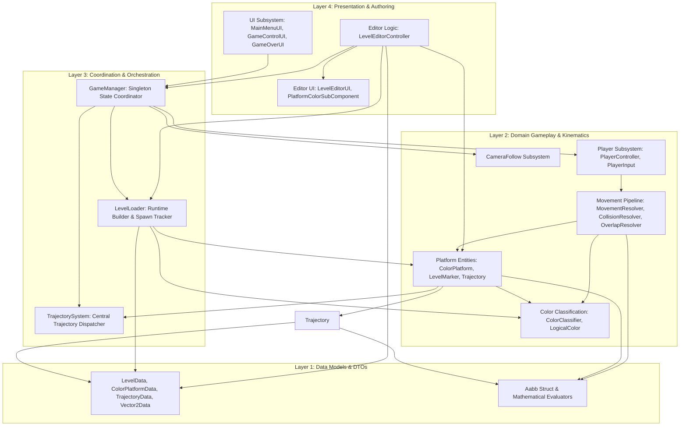

# Architecture: Contrast

> **Target Audience:** Software architects, lead engineers, and AI agents needing a definitive reference on layer boundaries, dependency flow, state ownership, and design patterns across the Contrast codebase.

---

## 1. Architectural Layers & Separation of Concerns

The Contrast architecture is partitioned into four well-defined layers, strictly enforcing unidirectional dependencies from presentation and editor layers down to data models:



---

## 2. Architectural Patterns Actually in Use

Rather than theoretical clean-architecture abstractions, the project employs several concrete, battle-tested patterns:

### 2.1 Centralized Coordinator / Mediator (`GameManager`)
- **Pattern:** Singleton Coordinator (`GameManager.Instance`).
- **Role:** Owns high-level state (`GameState`). Rather than letting individual components update themselves autonomously in unpredictable Unity execution orders, `GameManager.Update()` coordinates the entire gameplay pipeline linearly.

### 2.2 Global Entity Registries (`ColorPlatform.All` & `LevelMarker.All`)
- **Pattern:** Static Registry Pattern (`List<ColorPlatform> All`, `List<LevelMarker> All`).
- **Role:** Eliminates costly `FindObjectsByType` queries during collision resolution and trajectory updates. Platforms and markers automatically register in `Initialize()` / `Awake()` and deregister in `OnDestroy()`.
- **Lifecycle Guard:** `ColorPlatform` is marked with `[ExecuteAlways]` to guarantee that `OnDestroy()` unregisters instances during editor operations and test teardowns.

### 2.3 Pure Functional Pipeline Pattern (`PlayerMovementResolver`)
- **Pattern:** Immutable/Pure Calculation Pipeline.
- **Role:** `PlayerMovementResolver`, `PlayerCollisionResolver`, and `PlayerOverlapResolver` **never** mutate `Transform.position` or `Rigidbody2D` state directly. They receive positions and intent vectors, execute pure mathematical transformations, and return read-only structs (`MovementResult`, `CollisionResult`, `OverlapResult`). The single authoritative write to `transform.position` occurs in `PlayerController.ApplyMove()`.

### 2.4 Data Transfer Object (DTO) / Serializable Schema
- **Pattern:** Anemic Data Model / DTO.
- **Role:** `LevelData`, `ColorPlatformData`, `TrajectoryData`, and `StartPosData` are pure serializable classes without game engine logic. They decouple JSON persistence from runtime `MonoBehaviour` instances.

### 2.5 Programmatic Immediate-Mode UI Factory
- **Pattern:** Procedural uGUI Construction.
- **Role:** UI is generated entirely through C# code at initialization (`LevelEditorUI.BuildUI()`, `MainMenuUI.BuildUI()`). Panels and controls hook directly into controller callbacks without relying on serialized Unity prefab GUIDs.

---

## 3. State Ownership & Source of Truth

Understanding which class owns which state is critical before modifying code:

| State Domain | Authoritative Owner | Consumers / Observers | Mutation Point |
|---|---|---|---|
| **High-level Game State** (`MainMenu`, `Playing`, `Editing`, etc.) | `GameManager.State` | All UI classes, `PlayerController`, `LevelEditorController` | `GameManager.SetState()` |
| **Player World Position** | `PlayerController.transform.position` | `CameraFollow`, `PlayerMovementResolver`, `LevelMarker` | `PlayerController.ApplyMove()` (or `Respawn()`) |
| **Player Current Color** | `PlayerController.CurrentColor` | `PlayerCollisionResolver`, `PlayerOverlapResolver`, `SpriteRenderer` | `PlayerController.SetColor()` |
| **Active Level Data (Imported/Live)** | `LevelLoader.CurrentLevelData` | `LevelEditorController.BuildExportData()`, `LevelLoader.BuildRuntimeLevel()` | `LevelLoader.LoadAndInitializeLevel()`, `BuildRuntimeLevel()` |
| **Active Respawn Spawn Point** | `LevelLoader.CurrentSpawnPosition`, `CurrentSpawnColor` | `PlayerController.Respawn()` | `LevelLoader.ProcessPlayerInteractions()` on checkpoint contact |
| **Kill Plane Threshold** | `LevelLoader.KillY` | `PlayerController.ProcessUpdate()` | Calculated in `LevelLoader.ComputeKillY()` |
| **Platform Geometry (Position & Size)** | `ColorPlatform.Position`, `Size` | `PlayerCollisionResolver`, `LevelEditorController`, Trajectory math | `ColorPlatform.Initialize()`, `SetEditorData()` |
| **Platform Trajectory State** | `Trajectory.Config`, `Phase` | `TrajectorySystem`, `LevelEditorUI` | `Trajectory.SetConfig()`, `ProcessUpdate()`, `ResetPhase()` |
| **Editor Selection & Active Handle** | `LevelEditorController.selectedPlatform`, `activeHandle` | `LevelEditorUI`, `EditorHandles` | `LevelEditorController.SelectPlatform()`, `BeginMapPointer()` |

---

## 4. Runtime vs. Editor Separation

The project maintains clean behavioral boundaries between runtime play and editor manipulation:

```text
               ┌────────────────────────────────────────────────────────┐
               │                  GameManager.State                     │
               └───────────────┬────────────────────────┬───────────────┘
                               │                        │
                    State == Playing           State == Editing
                               │                        │
                               ▼                        ▼
               ┌───────────────────────┐ ┌──────────────────────────────┐
               │    GAMEPLAY MODE      │ │         EDITOR MODE          │
               ├───────────────────────┤ ├──────────────────────────────┤
               │ • Player Active       │ │ • Player Deactivated         │
               │ • Trajectory Active   │ │ • Trajectory Frozen          │
               │ • Rider Carry Active  │ │ • Camera Pan (MMB) Active    │
               │ • Checkpoints Active  │ │ • Click/Drag Selection Active│
               │ • Collision Active    │ │ • Handles Visible (4 + Traj) │
               │ • Death (KillY) Active│ │ • UI Inspector & Palette     │
               └───────────────────────┘ └──────────────────────────────┘
```

### Critical Separation Constraints:
1. **Trajectory Execution Isolation:** `TrajectorySystem.UpdateAll()` is **only** called from `GameManager.Update()` when `State == GameState.Playing`. Trajectories NEVER advance automatically while in `GameState.Editing`, `GameState.MainMenu`, `GameOver`, or `Won`.
2. **Editor Platform Modification:** In editor mode, moving a platform translates its trajectory origin in lockstep (`originX += delta.x`, `originY += delta.y`). In play mode, trajectory evaluation updates the platform position dynamically, leaving `originX/Y` untouched.
3. **Camera Decoupling:** `CameraFollow` is active during gameplay to track the player. In editor mode, middle-mouse dragging directly translates the `Camera.main.transform`, temporarily bypassing `CameraFollow`.

---

## 5. Architectural Constraints & Non-Negotiable Invariants

1. **Deterministic Single Gameplay Update:** No secondary `Update()` or `FixedUpdate()` loops may advance player position or platform trajectories. Everything must flow through `GameManager.Update()`.
2. **Axis-Aligned Bounding Box (AABB) Invariance:** Platform GameObjects must remain axis-aligned (`rotation == 0`). Trajectory rotation operates solely on evaluation coordinates.
3. **Coordinate Contract on Export:** When exporting to JSON, platform coordinates must export the **initial evaluated position** of the trajectory (`Trajectory.GetInitialPosition()`) to prevent frame-0 jumps on level reload.
4. **Registry Integrity:** Any dynamic destruction of a `ColorPlatform` must deregister from `ColorPlatform.All` immediately to prevent dangling null pointers in collision loops.

---

## 6. Related Documentation
- [00_PROJECT_MAP.md](00_PROJECT_MAP.md) — System navigation and routing
- [03_RUNTIME_FLOW.md](03_RUNTIME_FLOW.md) — Detailed frame-by-frame execution sequence
- [04_DATA_MODEL.md](04_DATA_MODEL.md) — Complete data structures and DTO schemas
- [INVARIANTS.md](INVARIANTS.md) — Exhaustive catalog of non-negotiable architectural rules
- [MODULES/Core.md](MODULES/Core.md) — `GameManager` and `GameState` specifics
