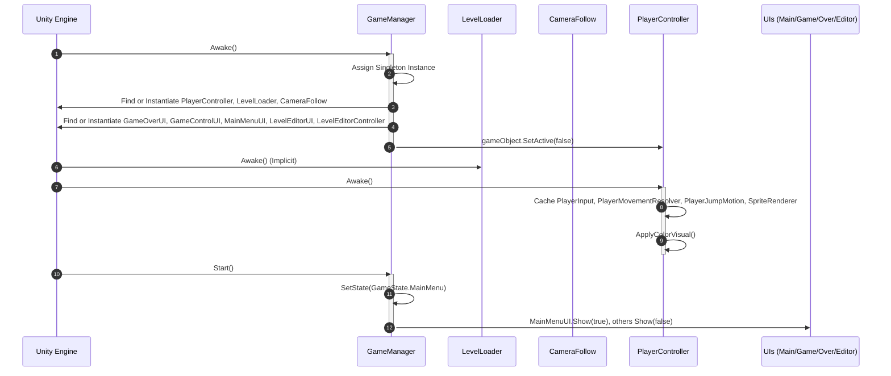
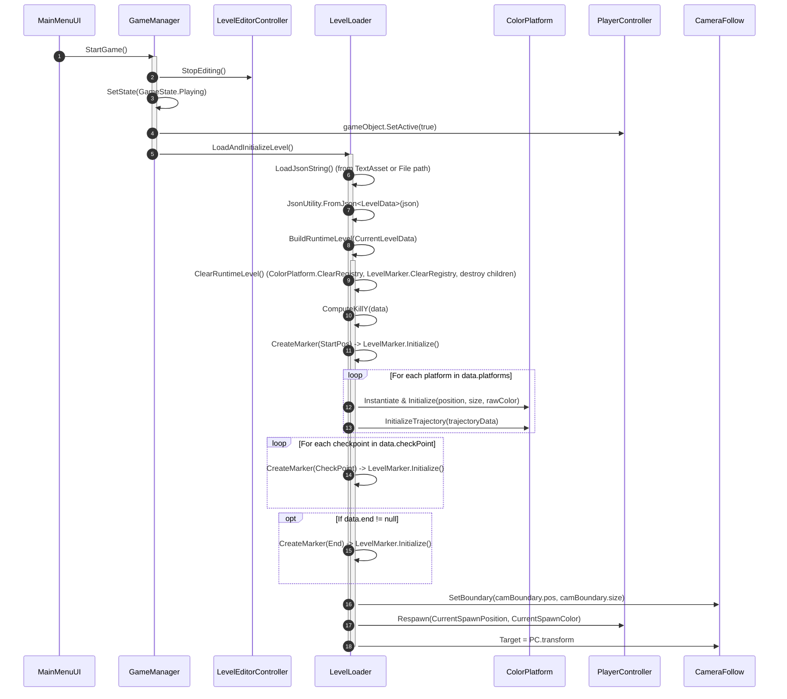
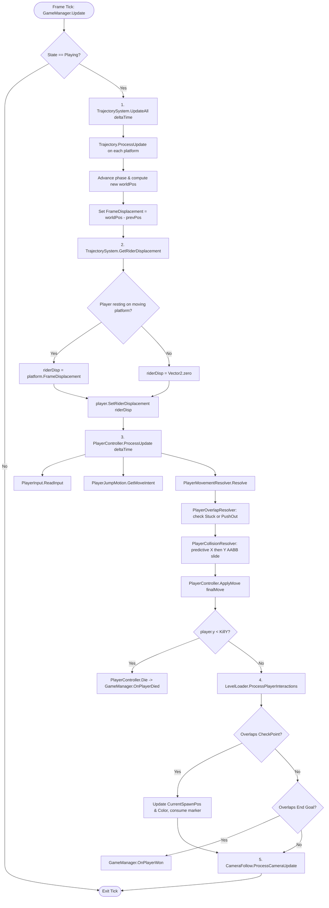

# Runtime Flow: Contrast

> **Target Audience:** Engineers and AI assistants who need to trace the exact chronological sequence of method calls, state transitions, physics evaluations, and UI events across all runtime scenarios.

---

## 1. Application Startup & Initialization Sequence

The game initializes in `Assets/Scenes/SampleScene.unity`. The boot progression proceeds as follows:

### Exact Call Signatures:
1. [`GameManager.Awake()`](file:///y:/Contrast/My%20project/Assets/Script/Contrast/Core/GameManager.cs#L36-L72):
   - Sets `Instance = this`.
   - Discovers or creates `PlayerController`, `LevelLoader`, `CameraFollow`.
   - Procedurally creates missing UI GameObjects: `new GameObject("GameOverUI").AddComponent<GameOverUI>()`, `MainMenuUI`, `GameControlUI`, `LevelEditorController`, `LevelEditorUI`.
   - Deactivates `PlayerController.gameObject` while in main menu.
2. [`GameManager.Start()`](file:///y:/Contrast/My%20project/Assets/Script/Contrast/Core/GameManager.cs#L74-L77):
   - Calls `SetState(GameState.MainMenu)`.
   - `MainMenuUI.Show(true)` activates the top-level title screen canvas.

---

## 2. Game Start & Level Loading Flow

When the user clicks the **PLAY GAME** button on the main menu:

### Exact Call Signatures:
- [`MainMenuUI.OnPlay()`](file:///y:/Contrast/My%20project/Assets/Script/Contrast/UI/MainMenuUI.cs#L80) $\to$ [`GameManager.StartGame()`](file:///y:/Contrast/My%20project/Assets/Script/Contrast/Core/GameManager.cs#L113-L125).
- [`LevelLoader.BuildRuntimeLevel(LevelData data)`](file:///y:/Contrast/My%20project/Assets/Script/Contrast/Level/LevelLoader.cs#L87-L256):
  - Clears `ColorPlatform.All` and `LevelMarker.All`.
  - Calculates `KillY` (defaulting to bottom camera boundary $- 1\text{m}$, or lowest platform $- 10\text{m}$).
  - Spawns platforms and calls `platform.InitializeTrajectory(pData.trajectory)`.
  - Calls `player.Respawn(CurrentSpawnPosition, CurrentSpawnColor)`.

---

## 3. The Authoritative Gameplay Frame Update Loop

During `GameState.Playing`, [`GameManager.Update()`](file:///y:/Contrast/My%20project/Assets/Script/Contrast/Core/GameManager.cs#L80-L111) is the **only** entry point that advances gameplay.

---

## 4. Player Input & Color Shifting Flow

Input handling is completely decoupled from position mutation:
1. [`PlayerInput.ReadInput(deltaTime, moveSpeed, isGrounded)`](file:///y:/Contrast/My%20project/Assets/Script/Contrast/Player/Input/PlayerInput.cs#L18-L134):
   - Polls `Keyboard.current` (Input System) or `Input.GetKey` (Legacy).
   - Computes horizontal movement intent: $v_x = (\text{Key}_D - \text{Key}_A) \cdot \text{moveSpeed} \cdot \Delta t$.
   - Detects Jump intent (`SpaceKey.wasPressedThisFrame && isGrounded`).
   - Detects Color intent:
     - Direct keys: `1` (White), `2` (Gray), `3` (Black).
     - Stepping keys: `Right`/`Up` Arrow ($+1$), `Left`/`Down` Arrow ($-1$).
   - Returns immutable struct `PlayerInputIntent`.
2. [`PlayerController.StepColorChunk(int direction)`](file:///y:/Contrast/My%20project/Assets/Script/Contrast/Player/PlayerController.cs#L181-L208):
   - Advances cycle: $\text{White} \to \text{Gray} \to \text{Black} \to \text{White}$.
   - Updates `currentColorValue` and triggers `ApplyColorVisual()` to update player sprite grayscale shading.

---

## 5. Movement & Collision Resolution Pipeline

Inside [`PlayerMovementResolver.Resolve()`](file:///y:/Contrast/My%20project/Assets/Script/Contrast/Player/Movement/PlayerMovementResolver.cs#L29-L148):

1. **Overlap Evaluation:** [`PlayerOverlapResolver.Evaluate(currentBounds, playerColor)`](file:///y:/Contrast/My%20project/Assets/Script/Contrast/Player/Movement/PlayerOverlapResolver.cs#L59-L165):
   - Computes overlap area between player AABB and all blocking platforms.
   - If $\text{overlapArea} / \text{playerArea} \ge 50\%$ (`stuckOverlapPercent`), returns `IsStuck = true`.
   - If $0 < \text{overlap} < 50\%$, calculates minimal escape vector (nearest edge: Left, Right, Up, Down).
2. **Intent Combination:**
   - Controls are reduced by $80\%$ during push-out (`overlapSpeedReductionPercent`).
   - Vertical push-out speed is scaled to exceed current fall velocity by `verticalPushSpeedMargin` ($2.0\,\text{m/s}$).
   - $\mathbf{v}_{\text{combined}} = \mathbf{v}_{\text{input, adjusted}} + \mathbf{v}_{\text{jump}} + \mathbf{v}_{\text{push}} + \mathbf{v}_{\text{rider}}$.
3. **Predictive Collision Resolution:** [`PlayerCollisionResolver.Resolve()`](file:///y:/Contrast/My%20project/Assets/Script/Contrast/Player/Movement/PlayerCollisionResolver.cs#L31-L103):
   - **Horizontal Resolution:** Predicts candidate position along X. If candidate overlaps a non-escaped blocking platform, snaps player edge to platform edge minus `collisionEpsilon` ($0.0001\,\text{m}$).
   - **Vertical Resolution:** Predicts candidate position along Y from resolved X. If falling onto a platform, snaps player bottom to platform top, setting `blockedDownward = true`.
   - **Ground Support:** Checks if bottom edge has ground support within `groundEpsilon` ($0.02\,\text{m}$).
4. **Position Application:**
   - [`PlayerController.ApplyMove(result.FinalMove)`](file:///y:/Contrast/My%20project/Assets/Script/Contrast/Player/PlayerController.cs#L162-L179) writes the resolved displacement to `transform.position`.

---

## 6. Death, Checkpoint, and Retry Flows

### 6.1 Death / Game Over Flow
1. Condition: `player.transform.position.y < GameManager.Instance.KillY`.
2. `PlayerController.Die()` sets `State = PlayerState.Dead` and calls `GameManager.Instance.OnPlayerDied()`.
3. `GameManager.OnPlayerDied()` sets `State = GameState.GameOver`.
4. `GameOverUI.ShowResult(true, "GAME OVER", allowRetry: true)` presents the game-over screen.
5. Pressing `R`, `Enter`, or clicking **RETRY** calls `GameManager.Retry()`.

### 6.2 Checkpoint Interaction Flow
1. In `GameManager.Update()`, [`LevelLoader.ProcessPlayerInteractions(player)`](file:///y:/Contrast/My%20project/Assets/Script/Contrast/Level/LevelLoader.cs#L294-L341) checks overlap against `LevelMarker.All`.
2. When player bounds overlap an unconsumed `CheckPoint`:
   - `CurrentSpawnPosition = marker.Position`.
   - `CurrentSpawnColor = marker.LogicalColor`.
   - `marker.OnPlayerTouched()` destroys the marker GameObject.

### 6.3 Retry Flow (Fast Respawn)
1. [`GameManager.Retry()`](file:///y:/Contrast/My%20project/Assets/Script/Contrast/Core/GameManager.cs#L202-L213) $\to$ [`LevelLoader.RetryCurrentSpawn()`](file:///y:/Contrast/My%20project/Assets/Script/Contrast/Level/LevelLoader.cs#L262-L289).
2. Level geometry is **NOT** reloaded from JSON.
3. Central reset: `TrajectorySystem.ResetAll()` deterministically snaps all moving platforms back to phase 0 (or 1 if reversed).
4. `player.Respawn(CurrentSpawnPosition, CurrentSpawnColor)` snaps the player to the active spawn point.

### 6.4 Full Restart Flow
1. [`GameManager.Restart()`](file:///y:/Contrast/My%20project/Assets/Script/Contrast/Core/GameManager.cs#L189-L200) $\to$ [`LevelLoader.LoadAndInitializeLevel()`](file:///y:/Contrast/My%20project/Assets/Script/Contrast/Level/LevelLoader.cs#L37-L63).
2. Entire runtime level hierarchy is destroyed and reconstructed from scratch from JSON.

---

## 7. Victory / End Game Flow
1. Player overlaps `LevelMarkerType.End`.
2. `LevelLoader.ProcessPlayerInteractions()` triggers `marker.OnPlayerTouched()` and calls [`GameManager.Instance.OnPlayerWon()`](file:///y:/Contrast/My%20project/Assets/Script/Contrast/Core/GameManager.cs#L182-L187).
3. `GameManager.SetState(GameState.Won)`.
4. `GameOverUI.ShowResult(true, "YOU WIN", allowRetry: false)` displays the victory screen with a **RESTART** option.

---

## 8. In-Editor Test Play Bridge Flow
1. User clicks **TEST PLAY** in the level editor toolbar.
2. [`LevelEditorUI`](file:///y:/Contrast/My%20project/Assets/Script/Contrast/UI/LevelEditorUI.cs) calls [`LevelEditorController.RequestPlayLevel()`](file:///y:/Contrast/My%20project/Assets/Script/Contrast/Level/LevelEditorController.cs#L242-L257).
3. `LevelEditorController.BuildExportData()` serializes the live editor objects into a transient in-memory `LevelData`.
4. `GameManager.StartGameWithLevelData(data)` transitions state to `Playing` and invokes `LevelLoader.BuildRuntimeLevel(data)`.
5. Gameplay starts immediately from authored coordinates without touching disk.
