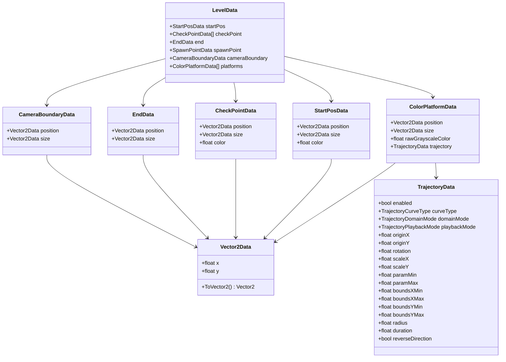

# Data Model: Contrast

> **Target Audience:** Systems engineers and AI agents needing an exact specification of all data structures, serialization schemas, runtime/transient fields, and state derivation rules.

---

## 1. Class, Struct, and Enum Inventory



---

## 2. Serialized Level Schema (`LevelData.cs`)

All files stored under `Assets/Levels/` adhere to the `LevelData` JSON model:

### 2.1 Schema Tables

#### Root Level Object: `LevelData`
| Field Name | Type | Nullable? | Description / Semantics |
|---|---|:---:|---|
| `startPos` | `StartPosData` | Yes | Modern player spawn coordinates, dimensions, and initial color. |
| `checkPoint` | `CheckPointData[]` | Yes | Ordered collection of checkpoints. |
| `end` | `EndData` | Yes | Terminal level goal rectangle. |
| `spawnPoint` | `SpawnPointData` | Yes | **Legacy fallback**; used if `startPos` is missing. |
| `cameraBoundary` | `CameraBoundaryData` | Yes | Rectangular bounding box constraining `CameraFollow`. |
| `platforms` | `ColorPlatformData[]` | Yes | Array of authored static and moving platforms. |

#### Platform Definition: `ColorPlatformData`
| Field Name | Type | Default | Description / Semantics |
|---|---|---|---|
| `position` | `Vector2Data` | `(0, 0)` | Authored/spawn position. For moving platforms, this exports the **initial trajectory position** ($t=0$ or $1$). |
| `size` | `Vector2Data` | `(1, 1)` | Width and height of the platform AABB. |
| `rawGrayscaleColor` | `float` | `255.0` | Value from 0.0 to 255.0 determining logical color. |
| `trajectory` | `TrajectoryData` | `null` | Optional motion parameters. `null` or `enabled=false` represents a stationary platform. |

#### Parametric Motion: `TrajectoryData`
| Field Name | Type | Default | Semantics & Constraints |
|---|---|---|---|
| `enabled` | `bool` | `false` | Master toggle. If false, platform remains static. |
| `curveType` | `TrajectoryCurveType` | `Line (0)` | `0 = Line`, `1 = Circle`. Serialized as integer by Unity. |
| `domainMode` | `TrajectoryDomainMode` | `ParameterRange (0)` | `0 = ParameterRange`, `1 = SpatialBounds` (Line only). |
| `playbackMode` | `TrajectoryPlaybackMode` | `PingPong (1)` | `0 = Loop`, `1 = PingPong`, `2 = Once`. |
| `originX`, `originY` | `float` | `0, 0` | World anchor point. For Line: phase 0 endpoint. For Circle: center point. |
| `rotation` | `float` | `0.0` | Angle in degrees counter-clockwise (Line direction). Ignored by Circle. |
| `scaleX` | `float` | `5.0` | Total segment length when `paramMin=0, paramMax=1`. |
| `paramMin`, `paramMax` | `float` | `0.0, 1.0` | Domain bounds. For Line: parameter span. For Circle: start/end angles in degrees. |
| `boundsXMin`, `boundsXMax` | `float` | `-10, 10` | Horizontal spatial clipping box for `SpatialBounds` mode. |
| `boundsYMin`, `boundsYMax` | `float` | `-10, 10` | Vertical spatial clipping box for `SpatialBounds` mode. |
| `radius` | `float` | `2.0` | World-space circle radius. Must be $> 0$. |
| `duration` | `float` | `4.0` | Traversal duration in seconds. For PingPong: round-trip time ($2T$). Must be $> 0$. |
| `reverseDirection` | `bool` | `false` | If true, phase starts at $1.0$ and steps backward toward $0.0$. |

---

## 3. Runtime State & Transient Structs

### 3.1 Custom Geometry Representation (`MovementGeometry.cs`)
```csharp
public readonly struct Aabb
{
    public readonly Vector2 Min;
    public readonly Vector2 Max;
    public Vector2 Center => (Min + Max) * 0.5f;
    public Vector2 Size => Max - Min;
}
```
- Completely value-type struct used for spatial overlap queries and predictive collision clamping.
- Avoids garbage collection allocations during high-frequency frame ticks.

### 3.2 Movement Evaluation Structs
- [`PlayerInputIntent`](file:///y:/Contrast/My%20project/Assets/Script/Contrast/Player/Input/PlayerInput.cs#L136-L157): Contains `Vector2 Move`, `bool JumpRequested`, `bool HasColorChange`, `LogicalColor RequestedColor`, `int ColorChunkStep`.
- [`OverlapResult`](file:///y:/Contrast/My%20project/Assets/Script/Contrast/Player/Movement/PlayerOverlapResolver.cs#L209-L228): Contains `bool IsStuck`, `bool IsPushingOut`, `float OverlapPercent`, `Vector2 PushDirection`.
- [`CollisionResult`](file:///y:/Contrast/My%20project/Assets/Script/Contrast/Player/Movement/PlayerCollisionResolver.cs#L337-L356): Contains `Vector2 FinalMove`, `bool IsGrounded`, `bool BlockedX`, `bool BlockedY`.
- [`MovementResult`](file:///y:/Contrast/My%20project/Assets/Script/Contrast/Player/Movement/PlayerMovementResolver.cs#L150-L187): Comprehensive output bundling `FinalMove`, flags, and intermediate vectors for logging.

### 3.3 Trajectory Dynamic State (`Trajectory.cs`)
- `private float phase`: Normalized parameter $t \in [0, 1]$.
- `private int pingPongDir`: $+1$ (forward), $-1$ (reverse).
- `private Vector2 previousWorldPosition`: Position from the previous frame tick.
- `public Vector2 FrameDisplacement`: Exact delta $\mathbf{x}_t - \mathbf{x}_{t-1}$ transferred to rider entities.

---

## 4. Source of Truth vs. Derived Data

| Data Point | Source of Truth | Derived Representation | Derivation Rule |
|---|---|---|---|
| **Platform Color** | `ColorPlatform.rawGrayscaleColor` | `ColorPlatform.Logical` | `ColorClassifier.Classify(rawColor)` |
| **Platform AABB** | `ColorPlatform.Position` & `Size` | `ColorPlatform.GetAabb()` | `new Rect(pos - size * 0.5f, size)` |
| **Initial Platform Spawn** | `TrajectoryData` (if active) | `ColorPlatformData.position` | `Trajectory.GetInitialPosition(trajData)` |
| **Active Player Respawn** | `LevelLoader.CurrentSpawnPosition` | `player.transform.position` | Written via `player.Respawn(...)` |
| **Line Domain** | `TrajectoryData.paramMin/Max` or Spatial Bounds | Effective domain `[pMin, pMax]` | Evaluated via `Trajectory.GetLineDomain()` |
| **Kill Plane** | `CameraBoundaryData.position/size` | `LevelLoader.KillY` | `boundary.y - boundary.height * 0.5f - 1.0f` |

---

## 5. Backward Compatibility & Serialization Notes

1. **Missing Trajectory Object:** Legacy JSON files without `"trajectory"` deserialize with `trajectory = null`. `LevelLoader` interprets `null` as stationary.
2. **Checkpoint Array vs. Single Object:** Older JSON formats (`SampleLevel.json`) serialized `"checkPoint": { ... }` as an object, while modern schema expects an array `[ { ... } ]`. When `JsonUtility` parses a single object into an array field, it sets `checkPoint = null`. `LevelLoader` safely guards against null arrays (`data.checkPoint != null`).
3. **Legacy `spawnPoint`:** If `data.startPos` is null, `LevelLoader.ConvertLegacySpawnPoint()` reads `data.spawnPoint` and converts `initialPlayerColor` into modern `StartPosData`.
