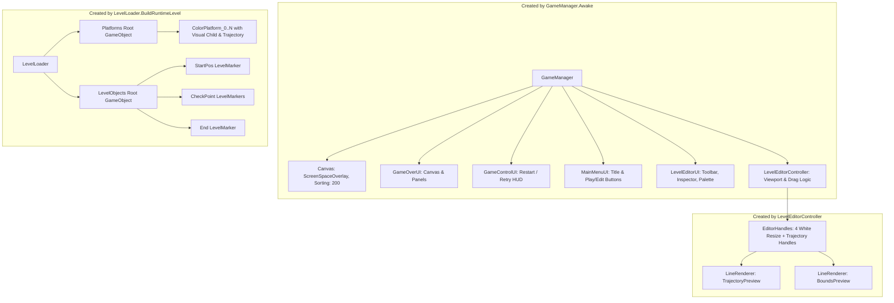

# Scene & Hierarchy Guide: Contrast

> **Target Audience:** Engineers and AI assistants who need to understand exactly which GameObjects exist in the Unity scenes, which scripts are attached to them, how references are wired, and what objects are spawned dynamically at runtime or in edit mode.

---

## 1. Scene Catalog

| Scene File Path | Role & Status | Key Root GameObjects |
|---|---|---|
| [`Assets/Scenes/SampleScene.unity`](file:///y:/Contrast/My%20project/Assets/Scenes/SampleScene.unity) | **Authoritative Active Scene.** Used for editor execution, playtesting, and batchmode tests. | `Main Camera`, `Global Light 2D`, `Player`, `GameSystems` |
| [`Assets/_Recovery/0.unity`](file:///y:/Contrast/My%20project/Assets/_Recovery/0.unity) | **Legacy Auto-Recovery Scene.** Stale snapshot containing older deprecated components. | `Main Camera`, `Global Light 2D`, `GameSystems`, `Player` |
| [`Assets/Settings/Scenes/URP2DSceneTemplate.unity`](file:///y:/Contrast/My%20project/Assets/Settings/Scenes/URP2DSceneTemplate.unity) | Engine default template for new URP 2D scenes. | `Main Camera`, `Global Light 2D` |

---

## 2. Authoritative Scene Hierarchy (`SampleScene.unity`)

```text
SampleScene
├── Main Camera (Tag: MainCamera)
│   ├── Transform (pos: 0, 0, -10)
│   ├── Camera (Orthographic, Size: 5, Near: 0.3, Far: 1000)
│   ├── AudioListener
│   ├── UniversalAdditionalCameraData (URP 2D)
│   └── CameraFollow.cs (target: Player, boundarySize: 40x20)
│
├── Global Light 2D
│   ├── Transform (pos: 0, 0, 0)
│   └── Light2D (Type: Global, Intensity: 1, Color: White)
│
├── Player (Layer: Default)
│   ├── Transform (pos: -1.7979, 4.4352, 0, scale: 0.3, 0.3, 1)
│   ├── SpriteRenderer (Sprite: Double Jump, SortingOrder: 0)
│   ├── Rigidbody2D (Dynamic, simulated: false, gravityScale: 3)
│   ├── PlayerController.cs (moveSpeed: 6, playerSize: 1x1, currentColor: Gray)
│   ├── PlayerMovementResolver.cs
│   ├── PlayerJumpMotion.cs (jumpHeight: 3, maxFallSpeed: 16)
│   ├── PlayerCollisionResolver.cs (collisionEpsilon: 0.0001, groundEpsilon: 0.02)
│   ├── PlayerOverlapResolver.cs (stuckOverlapPercent: 50, overlapPushSpeed: 2)
│   └── PlayerInput.cs (logInput: false)
│
└── GameSystems
    ├── Transform (pos: 1.959, 2.038, 0)
    ├── GameManager.cs (Coordinator, handles all state switches)
    ├── LevelLoader.cs (levelJsonAsset: SampleLevel, killY: -10)
    └── [Missing Script] (Legacy GUID: 797f4f9bbeb9abe48868f6ec62002cb9 -> UIManager)
```

---

## 3. GameObject → Component → Script Mapping

### 3.1 `Player` GameObject
- **Purpose:** Authoritative representation of the playable character.
- **Components Attached:**
  - `Transform`: Authoritative world position mutated only by `PlayerController.ApplyMove()` or `Respawn()`.
  - `SpriteRenderer`: Displays character graphics; color is modulated by `PlayerController.ApplyColorVisual()`.
  - `Rigidbody2D`: **Unsimulated** (`simulated = false`). Serves strictly as a container for `gravityScale` and vertical momentum in `PlayerJumpMotion`.
  - `PlayerController.cs`: Entry point for gameplay updates (`ProcessUpdate()`).
  - `PlayerMovementResolver.cs`: Coordinates overlap evaluation and predictive collision resolution.
  - `PlayerJumpMotion.cs`: Calculates jump impulse and integrates gravity deltas.
  - `PlayerCollisionResolver.cs`: Performs predictive AABB horizontal and vertical sliding.
  - `PlayerOverlapResolver.cs`: Evaluates anti-stuck conditions and escape vectors.
  - `PlayerInput.cs`: Polling bridge for keyboard controls.

### 3.2 `GameSystems` GameObject
- **Purpose:** Central manager root for game lifecycle, level construction, and UI creation.
- **Components Attached:**
  - `GameManager.cs`: Singleton coordinator (`Instance`). Manages `GameState`, executes the single gameplay `Update()` tick, and spawns UI elements on boot.
  - `LevelLoader.cs`: Parses JSON levels, creates platform hierarchies, computes `KillY`, and tracks active checkpoint spawns.
  - *Note on Missing Component:* Contains a dangling component referencing `Contrast.UI.UIManager`. This is a harmless historical artifact; `GameManager.Awake()` handles all necessary UI spawning directly.

### 3.3 `Main Camera` GameObject
- **Purpose:** Renders the 2D orthographic view and tracks player movement.
- **Components Attached:**
  - `Camera`: Orthographic camera.
  - `UniversalAdditionalCameraData`: URP 2D rendering pipeline integration.
  - `CameraFollow.cs`: Centers on `Player.transform` and clamps viewport within `LevelLoader`'s `CameraBoundaryData`.

---

## 4. Dynamically Spawned GameObjects (Runtime & Editor)

The following GameObjects do **NOT** exist in the serialized `.unity` scene asset; they are constructed procedurally at runtime:



### 4.1 Runtime Level Hierarchies
- **`Platforms/` Transform:** Parent container under `LevelLoader` holding all instantiated `ColorPlatform` objects.
  - **`ColorPlatform_i`:** Contains `ColorPlatform.cs`, optional `Trajectory.cs`, and a child GameObject `Visual` with a `SpriteRenderer`.
- **`LevelObjects/` Transform:** Parent container holding marker triggers.
  - **`StartPos`:** Persistent spawn marker (`LevelMarker.cs`).
  - **`CheckPoint`:** One-shot checkpoint markers (`LevelMarker.cs`).
  - **`End`:** Level completion goal (`LevelMarker.cs`).

### 4.2 Editor Viewport & Gizmo Hierarchies
- **`EditorHandles/` Transform:** Created by `LevelEditorController.EnsureHandleRoot()`.
  - Child sprites for Left, Right, Top, Bottom resize handles (`sortingOrder = 1005`).
  - Trajectory handles: `TrajOriginHandle` (Yellow), `TrajLineEndHandle` (Cyan), `TrajCircleCenterHandle` (Yellow), `TrajCircleRadiusHandle` (Magenta), `TrajArcStartHandle` / `TrajArcEndHandle` (Lime), `TrajBounds*Handle` (Orange).
  - `TrajectoryPreview` (`LineRenderer`, width: 0.06, sortingOrder: 990, color: Green).
  - `BoundsPreview` (`LineRenderer`, width: 0.04, sortingOrder: 990, color: Orange).

---

## 5. Dependency & Reference Wiring Table

| Referencing Script | Field / Property | Target Object in Scene / Runtime | Binding Method |
|---|---|---|---|
| `GameManager` | `player` | `Player` GameObject (`PlayerController`) | `FindAnyObjectByType<PlayerController>()` |
| `GameManager` | `levelLoader` | `GameSystems` GameObject (`LevelLoader`) | `FindAnyObjectByType<LevelLoader>()` |
| `GameManager` | `cameraFollow` | `Main Camera` GameObject (`CameraFollow`) | `FindAnyObjectByType<CameraFollow>()` |
| `GameManager` | `mainMenuUI` | Procedural `MainMenuUI` | Discovered or instantiated in `Awake()` |
| `GameManager` | `levelEditorUI` | Procedural `LevelEditorUI` | Discovered or instantiated in `Awake()` |
| `GameManager` | `levelEditor` | Procedural `LevelEditorController` | Discovered or instantiated in `Awake()` |
| `CameraFollow` | `target` | `Player.transform` | Assigned by `LevelLoader` on spawn |
| `LevelEditorController`| `levelLoader` | `GameSystems` (`LevelLoader`) | `FindAnyObjectByType<LevelLoader>()` |
| `LevelEditorController`| `ui` | Procedural `LevelEditorUI` | `FindAnyObjectByType<LevelEditorUI>()` |
| `LevelEditorUI` | `controller` | Procedural `LevelEditorController` | `FindAnyObjectByType<LevelEditorController>()` |
| `LevelLoader` | `platformsRoot` | Dynamically created `Platforms` transform | Created in `EnsureRoots()` |
| `LevelLoader` | `levelObjectsRoot` | Dynamically created `LevelObjects` transform | Created in `EnsureRoots()` |
