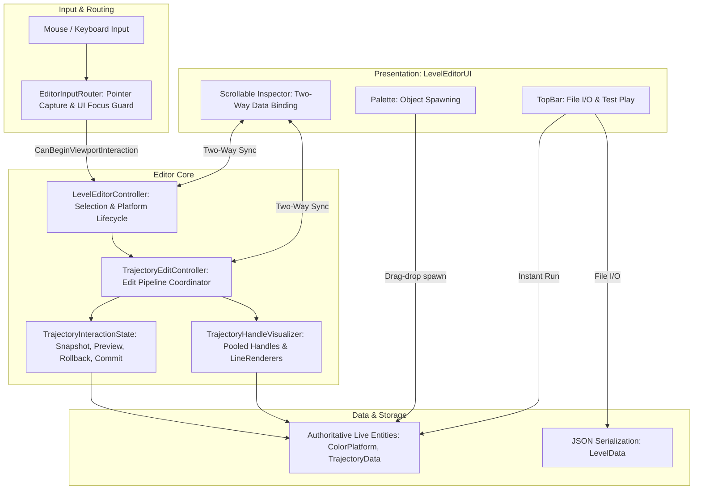

# Level Editor Architecture: Contrast

> **Target Audience:** Systems engineers, tool developers, and AI agents who need to understand or modify the in-engine runtime **Level Editor** subsystem (`LevelEditorController` and `LevelEditorUI`).

---

## 1. High-Level Architecture & Operating Modes

The Contrast Level Editor operates entirely inside the live Unity engine, functioning identically whether running inside the Unity Editor window or in a standalone build.



---

## 2. Universal Interaction Pipeline

Every editing action in the Level Editor follows a predictable, extensible operational pipeline:

```text
Raw Unity Input (Pointer Down / Move / Up / Keys)
        ↓
Input Routing (EditorInputRouter: Capture, UI Collision & Focus Guards)
        ↓
Hit Test & Active Tool (TrajectoryHandleVisualizer / Selection)
        ↓
Interaction State Machine (TrajectoryInteractionState: Snapshot, Preview)
        ↓
Editing Operation (Interactive Scrub / Drag / Lockstep Offset)
        ↓
Commit or Rollback (Pointer Up -> Commit, Escape -> Rollback)
        ↓
Authoritative Level Data (ColorPlatform.Position, Trajectory.Config)
        ↓
Viewport & Inspector Synchronization (Visualizer Refresh & LevelEditorUI Update)
```

---

## 3. Subsystem Breakdown

### 3.1 Selection & Hit-Testing System
- **Selection Kinds:** Managed via `SelectionKind` enum (`None`, `Platform`, `Marker`).
- **Hit Detection:**
  - Handles take priority: [`HitHandle(Vector2 world)`](file:///y:/Contrast/My%20project/Assets/Script/Contrast/Level/LevelEditorController.cs#L974) evaluates Euclidean distance against `handleHitRadius` ($0.35\,\text{m}$).
  - Platform detection: [`HitPlatform(world)`](file:///y:/Contrast/My%20project/Assets/Script/Contrast/Level/LevelEditorController.cs#L937) queries `ColorPlatform.All` in reverse order (top-most first) using `platform.GetAabb().Contains(world)`.
  - Marker detection: [`HitMarker(world)`](file:///y:/Contrast/My%20project/Assets/Script/Contrast/Level/LevelEditorController.cs#L953) queries `LevelMarker.All` using `marker.GetAabb().Overlaps()`.
- **Selection State Cleanliness:** Selecting a platform clears marker selection, un-focuses text fields, builds trajectory handle gizmos, and populates inspector fields.

### 3.2 Viewport Navigation (Camera Panning)
- **Control:** Middle Mouse Button (MMB) held over the map canvas.
- **Floating-Point Drift Prevention:**
  - On mouse-down, caches `panStartScreen` and `panStartCameraPosition`.
  - In `ContinueMapPan()`, computes world delta via:
    $$\Delta \mathbf{P} = \text{ScreenToWorldPoint}(\mathbf{p}_{\text{current}}) - \text{ScreenToWorldPoint}(\mathbf{p}_{\text{start}})$$
    $$\mathbf{P}_{\text{cam}} = \mathbf{P}_{\text{cam, start}} - \Delta \mathbf{P}$$
  - Operates strictly on `Camera.main.transform`, leaving platform and trajectory world coordinates untouched.

### 3.3 Platform Body Dragging & Lockstep Translation
- When dragging the central body of a platform (`activeHandle == HandleKind.None`):
  - Platform position is updated to `dragStartPosition + delta`.
  - **Lockstep Trajectory Synchronization:** If a trajectory is configured on the platform, its origin coordinates (`originX`, `originY`) and spatial bounds (`boundsXMin/Max`, `boundsYMin/Max`) are translated simultaneously by `delta.x` and `delta.y`.
  - This preserves relative motion paths without distorting authored offsets.

### 3.4 Interactive Resize Handles
- Four white handles positioned on the perimeter of the selected platform:
  - **`Left`:** Modifies `size.x` (offset $- \Delta x$) and centers $X$ ($x_0 + \Delta x \cdot 0.5$).
  - **`Right`:** Modifies `size.x` (offset $+ \Delta x$) and centers $X$ ($x_0 + \Delta x \cdot 0.5$).
  - **`Top`:** Modifies `size.y` (offset $+ \Delta y$) and centers $Y$ ($y_0 + \Delta y \cdot 0.5$).
  - **`Bottom`:** Modifies `size.y` (offset $- \Delta y$) and centers $Y$ ($y_0 + \Delta y \cdot 0.5$).
- Dimension clamping enforces a minimum size of $0.1\,\text{m}$ to prevent zero-volume geometry singularities.

### 3.5 Trajectory Manipulation Pipeline (`Contrast.Level.EditorInteraction`)
Trajectory editing is coordinated by [`TrajectoryEditController`](file:///y:/Contrast/My%20project/Assets/Script/Contrast/Level/EditorInteraction/TrajectoryEditController.cs) using a transactional interaction pipeline:

1. **Input Routing & Pointer Capture:**
   - [`EditorInputRouter`](file:///y:/Contrast/My%20project/Assets/Script/Contrast/Level/EditorInteraction/EditorInputRouter.cs) guarantees that drags can only start when the cursor is over the viewport (`!IsPointerOverUi()`).
   - Once a handle drag starts, the controller captures the pointer (`CapturePointer`). The ongoing drag is preserved even if the mouse sweeps over UI panels.
2. **Transactional State Machine (`TrajectoryInteractionState`):**
   - On pointer down, captures an immutable [`TrajectoryInteractionSnapshot`](file:///y:/Contrast/My%20project/Assets/Script/Contrast/Level/EditorInteraction/TrajectoryInteractionSnapshot.cs) containing the initial trajectory config, platform position, size, color, and normalized trajectory phase $t$.
   - Live dragging updates temporary preview geometry (`WorkingPreviewConfig`) and computes continuous platform alignment.
   - **Pointer Up (Commit):** Persists the preview state into the platform's authoritative `Trajectory.Config`, updates `ColorPlatform.Position`, and triggers two-way UI refresh.
   - **Escape Key or Interruption (Rollback):** Reverts `Trajectory.Config` and platform position cleanly to the pre-drag snapshot.
3. **Interactive Visual Handles (`TrajectoryHandleVisualizer`):**
   - **Yellow (`TrajOrigin` / `TrajCircleCenter`):** Translates world anchor $(x_0, y_0)$.
   - **Cyan (`TrajLineEnd`):** Adjusts line direction angle ($\theta$) and total scale/length ($\text{scaleX}$).
   - **Magenta (`TrajCircleRadius`):** Adjusts circular orbit radius ($r = \|\mathbf{Q} - \mathbf{C}\|$).
   - **Lime (`TrajArcStart` / `TrajArcEnd`):** Interactively scrubs angular boundaries ($\alpha_{\min}, \alpha_{\max}$) for circular arcs.
   - **Orange (`TrajBoundsMinX/MaxX/MinY/MaxY`):** Interactively drags edges of the Liang-Barsky axis-aligned bounding box.
4. **Lockstep Trajectory Translation:**
   - When the user drags or resizes a platform body, `TrajectoryEditController.ApplyLockstepOffset()` translates `origin` and `bounds` simultaneously by $\Delta \mathbf{P}$, keeping motion paths aligned with the platform.
5. **Idle Trajectory Anchoring:**
   - While idle in edit mode, platforms with enabled trajectories are continuously projected and anchored onto their curve (`EnsurePlatformOnTrajectory`), eliminating off-curve drift.

### 3.6 Two-Step Safe Deletion System
- **Problem Solved:** Accidental deletion of intricate platform setups via stray clicks or keyboard taps.
- **Workflow:**
  1. User selects a platform and clicks **DELETE PLATFORM** (red).
  2. Button transitions into confirmation mode (amber): label reads `"CONFIRM DELETE (CLICK AGAIN)"` with a 3.0-second expiry timer (`deleteConfirmExpiry`).
  3. If user clicks again within 3 seconds, `LevelEditorController.DeleteSelectedPlatform()` is invoked.
  4. If user clicks elsewhere or 3 seconds elapse, confirmation cancels automatically.
- **Keyboard Safety Guard:** Pressing `Delete` or `Backspace` deletes the platform **only** if no UI `InputField` currently has focus (`!IsInputFieldFocused()`).

### 3.7 In-Memory Test Play Bridge
- The emerald-green **TEST PLAY** button invokes [`LevelEditorController.RequestPlayLevel()`](file:///y:/Contrast/My%20project/Assets/Script/Contrast/Level/LevelEditorController.cs#L242).
- It calls `BuildExportData()` to serialize the live editor state into a temporary `LevelData` DTO, passes it to `GameManager.StartGameWithLevelData(data)`, and enters the active `Playing` state immediately without file I/O.

---

## 4. UI/Editor Communication & State Synchronization

```text
┌──────────────────────────────────────┐       ┌───────────────────────────────────────┐
│         LevelEditorController        │       │             LevelEditorUI             │
├──────────────────────────────────────┤       ├───────────────────────────────────────┤
│ • SelectPlatform(p)                  │ ────> │ • SetSelectedPlatform(p)              │
│ • ContinueMapPointer() [drag delta]  │ ────> │ • RefreshSelectedPlatform(p)          │
│ • ClearSelection()                   │ ────> │ • ClearSelectedPlatform()             │
│ • RefreshHandles()                   │       │ • UpdateTrajectorySummary()           │
│                                      │       │                                       │
│ • ApplySelectedPlatformFromUI(x,y..) │ <──── │ • OnEndEdit [Position, Size, Color]   │
│ • ApplySelectedTrajectoryFromUI(cfg) │ <──── │ • OnValueChanged [Dropdown, Toggles]  │
│ • DeleteSelectedPlatform()           │ <──── │ • OnDeleteButtonClicked()             │
│ • RequestPlayLevel()                 │ <──── │ • OnTestPlayClicked()                 │
└──────────────────────────────────────┘       └───────────────────────────────────────┘
```

- Two-way data binding uses internal suppression flags (`suppressFields`, `suppressTraj`) to avoid infinite event feedback loops when code-driven updates modify UI input fields.

---

## 5. UI Panel Structure & Layout Repacking

`LevelEditorUI.cs` contains dynamic row layout repacking logic:
- When curve type is `Line`, radius controls are hidden; rotation, scale, and spatial bounds rows are displayed.
- When curve type is `Circle`, rotation and scale rows are hidden; radius and angle rows are displayed.
- Total scroll content height (`contentRt.sizeDelta.y`) is dynamically recomputed based on visible rows, ensuring the native vertical scrollbar scales cleanly without overflow or dead zones.
