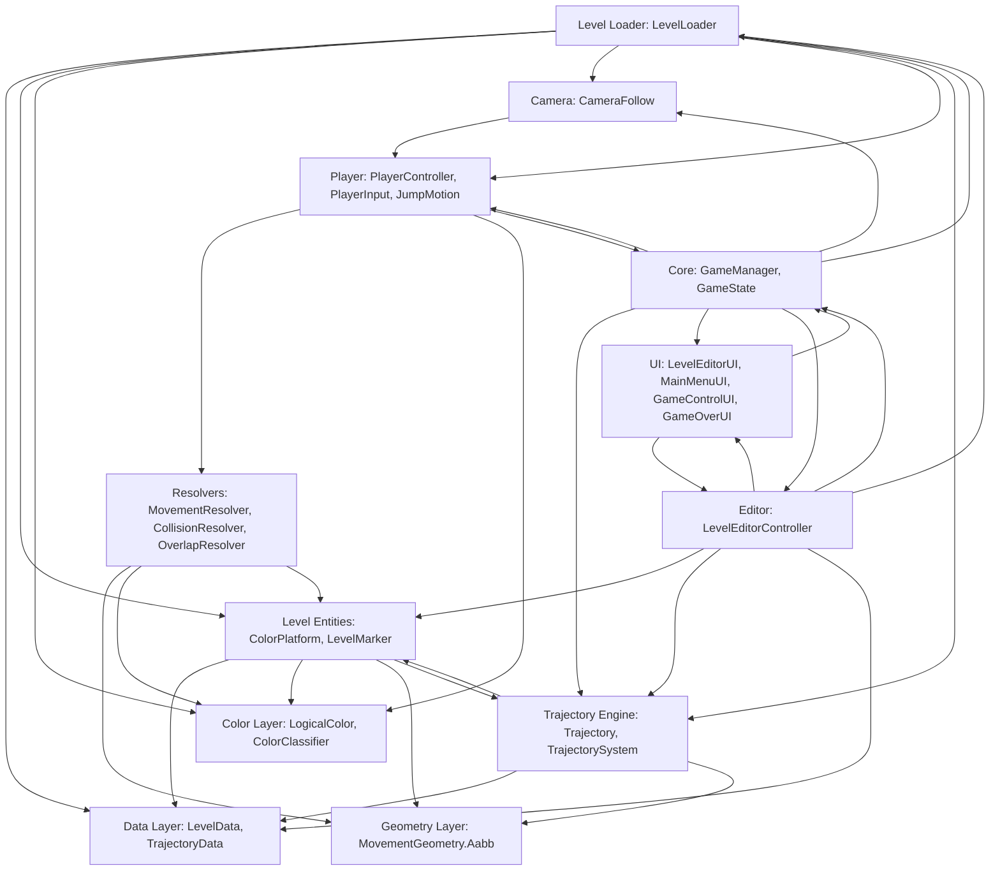

# Dependency Graph & Impact Radius: Contrast

> **Target Audience:** Systems engineers and AI agents planning modifications to the codebase. This document details caller/callee relationships, module coupling, side-effect hotspots, and provides an **Impact Radius Matrix** to evaluate regression risks before editing any file.

---

## 1. High-Level Subsystem Coupling Graph

---

## 2. Impact Radius Matrix

When planning a change to any source file, consult this table to assess the downstream systems that must be re-tested:

| Modified Source File | Direct Consumers (Callers / Importers) | Downstream Subsystems Affected | Regression Risk Level | Mandatory Validation Actions |
|---|---|---|:---:|---|
| **`LevelData.cs`** | `LevelLoader`, `LevelEditorController`, `TrajectoryData`, Test suites | JSON Persistence, Runtime Map Construction, Level Export/Import | **HIGH** | Run `ContrastTests` round-trip test; export and re-import sample JSON. |
| **`TrajectoryData.cs`** | `LevelData`, `Trajectory`, `TrajectorySystem`, `LevelEditorUI`, `LevelEditorController` | Moving platform motion, Editor Trajectory Inspector, Viewport Gizmos | **HIGH** | Run `ContrastTests` and `EditorLevelTests`; check Line/Circle/Arc presets. |
| **`MovementGeometry.cs`** | `PlayerCollisionResolver`, `PlayerOverlapResolver`, `LevelMarker`, `LevelEditorController` | All gameplay collision, jump landing, wall sliding, editor selection | **CRITICAL** | Full gameplay test: jump against corners, slide down walls, check ground stickiness. |
| **`ColorClassifier.cs`** | `ColorPlatform`, `PlayerController`, `LevelMarker`, `PlatformColorSubComponent` | Platform permeability, player color cycle, visual shaders | **HIGH** | Verify all 4 color ranges (0..84, 85..169, 170..254, 255) in play mode. |
| **`ColorPlatform.cs`** | `PlayerCollisionResolver`, `PlayerOverlapResolver`, `TrajectorySystem`, `LevelEditorController` | Collision detection, rider-carry, editor selection, level export | **CRITICAL** | Check `ColorPlatform.All` registry size; test platform deletion and export. |
| **`Trajectory.cs`** | `TrajectorySystem`, `ColorPlatform`, `LevelEditorController`, `LevelEditorUI` | Platform motion, rider displacement, visual preview line, gizmo handles | **HIGH** | Run `ContrastTests` (timing, projection, spatial clipping, reverse direction). |
| **`TrajectorySystem.cs`** | `GameManager.Update()`, `LevelLoader.RetryCurrentSpawn()` | Moving platform frame advancement, player rider momentum, checkpoint retry | **HIGH** | Stand on moving platform (Line, Circle, PingPong); verify rider carry without jitter. |
| **`PlayerController.cs`** | `GameManager`, `LevelLoader`, `CameraFollow` | Player movement, spawn, death, color state | **HIGH** | Test death plane (`KillY`), color shifting (`1, 2, 3`), jump responsiveness. |
| **`PlayerCollisionResolver.cs`** | `PlayerMovementResolver` | Horizontal/vertical collision snapping, surface sliding, ground support | **CRITICAL** | Run full physics audit; verify no sinking into platforms or catching on vertical seams. |
| **`PlayerOverlapResolver.cs`** | `PlayerMovementResolver` | Escape push-out, anti-stuck detection, input damping | **MEDIUM** | Test color shift while inside a platform; verify smooth ejection outward. |
| **`LevelLoader.cs`** | `GameManager`, `LevelEditorController` | Stage loading, platform instantiation, camera boundary setup, checkpoints | **HIGH** | Test **PLAY GAME**, **RESTART**, **RETRY**, and JSON file import. |
| **`LevelEditorController.cs`** | `GameManager`, `LevelEditorUI`, `EditorHandles` | Viewport panning, drag/resize handles, object deletion, level export | **HIGH** | Test platform move, 4 resize handles, MMB camera pan, two-step deletion. |
| **`LevelEditorUI.cs`** | `LevelEditorController`, `PlatformColorSubComponent` | Editor inspector, trajectory fields, scrollbar scaling, palette items | **MEDIUM** | Verify all inspector fields update on platform selection; check scrollbar. |

---

## 3. High-Risk Coupling & Side-Effect Hotspots

### 3.1 Static Registries: `ColorPlatform.All` & `LevelMarker.All`
- **Location:** [`ColorPlatform.cs`](file:///y:/Contrast/My%20project/Assets/Script/Contrast/Level/ColorPlatform.cs#L42) and [`LevelMarker.cs`](file:///y:/Contrast/My%20project/Assets/Script/Contrast/Level/LevelMarker.cs#L26).
- **Risk:** Stale references / Memory Leaks.
- **Why it matters:** `PlayerCollisionResolver`, `PlayerOverlapResolver`, and `TrajectorySystem` loop over `ColorPlatform.All` every frame. If an entity is destroyed without removing itself from `All`, a `NullReferenceException` will crash the gameplay update loop immediately.
- **Mitigation in Code:** `ColorPlatform` uses `[ExecuteAlways]` and `OnDestroy()` calls `All.Remove(this)`. `LevelEditorController.BuildExportData()` defensively runs `ColorPlatform.All.RemoveAll(p => p == null)`.

### 3.2 Authoritative Coordinate Contract on Export
- **Location:** [`LevelEditorController.BuildExportData()`](file:///y:/Contrast/My%20project/Assets/Script/Contrast/Level/LevelEditorController.cs#L865).
- **Risk:** Positional Teleportation Glitch on Level Reload.
- **Why it matters:** When a trajectory is active with `reverseDirection = true` or `SpatialBounds` clipping, the platform's current transform position or authored position may differ from the initial evaluated point of the trajectory.
- **Contract Enforced:** Export **must** write `Trajectory.GetInitialPosition(trajData)` to `ColorPlatformData.position`.

### 3.3 Rider-Carry Pre-Displacement Query
- **Location:** [`TrajectorySystem.GetRiderDisplacement()`](file:///y:/Contrast/My%20project/Assets/Script/Contrast/Level/TrajectorySystem.cs#L95-L98).
- **Risk:** False momentum or dropped rider.
- **Why it matters:** Platforms move in step 1 of `GameManager.Update()`. In step 2, rider detection evaluates player foot height against the platform's **prior** geometry ($y_{\text{max}} - \Delta y$). Changing the order of operations will break rider attachment.

### 3.4 Middle-Mouse Camera Pan vs. Canvas Dragging
- **Location:** [`LevelEditorController.Update()`](file:///y:/Contrast/My%20project/Assets/Script/Contrast/Level/LevelEditorController.cs#L370-L415).
- **Risk:** UI interaction leaking into viewport scene drags.
- **Mitigation in Code:** `EventSystem.current.IsPointerOverGameObject()` is queried before beginning or continuing any map drag. If cursor crosses onto a UI panel during a drag, the drag is aborted (`CancelMapPointerDrag`).

---

## 4. Circular Dependency Analysis

- **Current Status:** **CLEAN / NO CIRCULAR REFERENCES.**
- The data layer (`Contrast.Data`) has zero dependencies on Unity runtime components or presentation layers.
- The movement resolvers (`Contrast.Player`) depend on platform geometry interfaces, but `ColorPlatform` has no dependency on `PlayerMovementResolver`.
- `GameManager` coordinates presentation and domain systems without reverse tight coupling (UI classes invoke `GameManager` methods via public API or UnityEvents).
