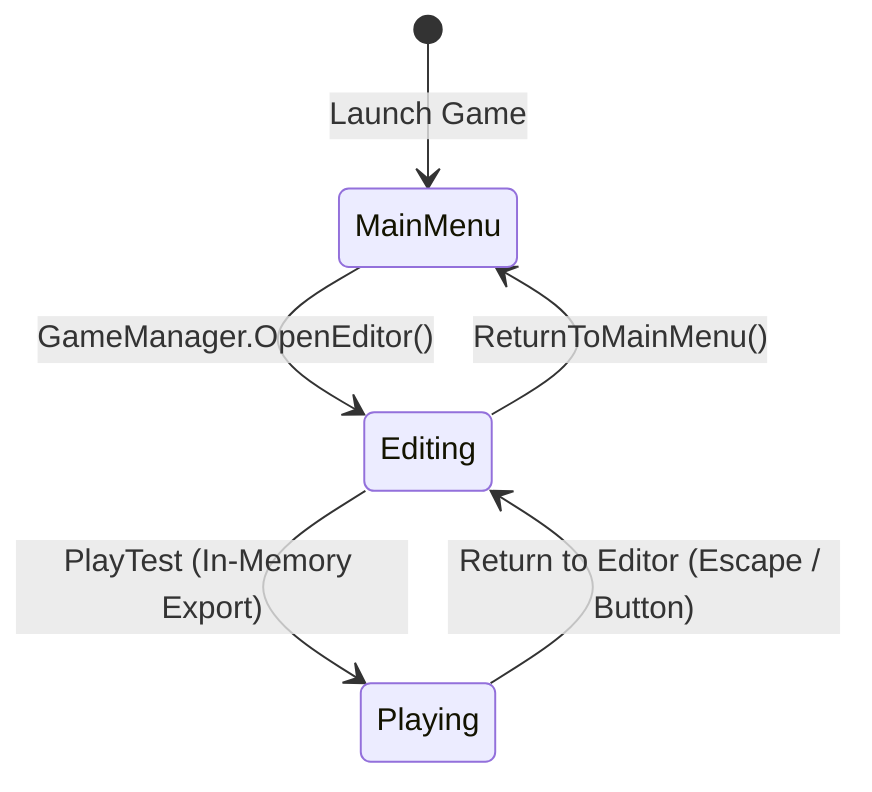
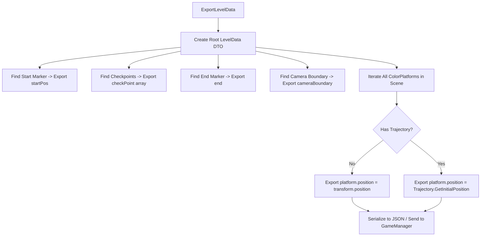

# Level Editor Developer Guide: Architecture & Principles

> **Target Audience:** Systems Engineers, Unity Developers, and AI Agents maintaining or extending the in-game Level Editor in Contrast.  
> **Source Status:** Confirmed from source code (`LevelEditorController.cs`, `LevelEditorUI.cs`, `LevelData.cs`, `TrajectoryData.cs`, `ColorPlatform.cs`, `LevelMarker.cs`, `LevelLoader.cs`).

---

## 1. Executive Summary & Design Philosophy

The **Level Editor** in Contrast is not an editor-only Unity tool (`UnityEditor`), but a **fully integrated runtime authoring suite**. It allows designers, players, or automated systems to construct, edit, serialize, and playtest levels directly within the compiled application.

### Key Architectural Principles:
1. **Live-World Editing (Zero Parallel Representation):** The editor does not operate on an abstract data proxy. Instead, it directly creates and manipulates the exact same Unity `GameObject` instances and components (`ColorPlatform`, `LevelMarker`, `Trajectory`) used during live gameplay.
2. **Deterministic Rest Position Contract:** Animated entities (platforms with trajectories) must serialize their mathematical rest position ($t=0$), never their transient animated coordinates.
3. **Procedural GUI Independence:** The editor UI is generated entirely through runtime C# scripts, avoiding fragile prefab GUID references and ensuring headless or clean instantiation.
4. **Instant In-Memory Playtesting:** Designers can toggle instantly between editing and playing via `GameManager.StartGameWithLevelData()` without touching the disk or reloading the scene.

---

## 2. Editor Mode & Lifecycle Management

### What It Does:
Controls the activation and deactivation of editor components, disabling gameplay logic (such as player gravity, collision resolution, and physics queries) while enabling mouse raycasting, gizmo rendering, and editor camera controls.

### Why It Exists / Problem Solved:
Prevents game physics from interfering with editing. If the player remained active in edit mode, falling through the world or triggering checkpoints would corrupt the authoring state.

### State Ownership:
- `GameManager.State` transitions to `GameState.Editing`.
- `LevelEditorController.IsActive` controls internal update loops.
- `PlayerController.gameObject` is set to `SetActive(false)`.

### Breakage Scenario:
If `PlayerController` is not deactivated, its gravity calculations or collision resolution against platforms being moved will cause physics errors and unwanted death/win events.

---

## 3. Subsystem Breakdown

### 3.1 Selection & Focus System
- **What It Does:** Translates 2D screen mouse clicks into selected game entities (`ColorPlatform`, `LevelMarker`, `CameraBoundary`).
- **Why It Exists:** Designers need visual feedback and focused inspection on a single entity at a time.
- **Implementation:**
  - `LevelEditorController.Update()` performs a 2D raycast using `Physics2D.Raycast(mouseWorldPos, Vector2.zero)` or manual AABB intersection testing against registered platforms and markers.
  - When hit, `Select(GameObject target)` caches the selection, instantiates or positions visual selection boundary handles, and fires `LevelEditorUI.OnSelectionChanged(target)`.
  - Clicking empty space (outside UI rects) calls `Deselect()`.
- **State Ownership:** Owned entirely by `LevelEditorController.selectedObject`.
- **Breakage Scenario:** If selection does not clear when clicking empty space, operations like box-scaling or keyboard shortcuts may mutate off-screen or unintended objects.

---

### 3.2 Transform & Handle Manipulation
- **What It Does:** Allows spatial positioning (translating) and resizing (scaling) of platforms and markers via mouse dragging.
- **Why It Exists:** Precise spatial placement requires both direct drag-and-drop and granular coordinate input fields.
- **Implementation:**
  - Four corner handles are rendered around the selected object's bounding box.
  - Mouse down on an object body initiates **Position Drag**: updates `transform.position` with mouse delta.
  - Mouse down on a corner handle initiates **Scale Drag**: updates `transform.localScale` and shifts origin appropriately to maintain axis alignment.
  - Both modes continuously call `platform.UpdateVisuals()` and refresh the inspector input fields.
- **State Ownership:** Scene GameObject `Transform` is the authoritative store; the UI reflects it.
- **Breakage Scenario:** If scaling does not clamp to a minimum size (e.g., width or height $\le 0.1$), platforms can invert their geometry, breaking collision normals and AABB algorithms.

---

### 3.3 Trajectory Authoring & Handles
- **What It Does:** Authors kinematic movement paths for moving platforms.
- **Why It Exists:** Moving platforms are a core mechanic; designers need to visualize and adjust origin anchors, path length/radius, angles, and speeds interactively.
- **Implementation:**
  - When a platform with `trajectory.enabled == true` is selected, `LevelEditorController` renders path gizmos and special trajectory handles:
    - **Origin Handle:** Moves `trajectory.originX / originY`.
    - **Extent / Radius Handle:** For `Line`, adjusts `scaleX` and `rotation`. For `Circle`, adjusts `radius`.
  - The path is sampled via `Trajectory.SampleCurve(32)` to generate a continuous visual preview polyline.
- **State Ownership:** Resides in the platform's attached `Trajectory.Data` (`TrajectoryData`).
- **Breakage Scenario:** Modifying the origin without updating the platform's rest position can cause the platform to jump across the screen when play mode starts.

---

### 3.4 Trajectory Live Preview
- **What It Does:** Simulates trajectory motion directly in the editor viewport without entering Play Mode.
- **Why It Exists:** Level designers need to test moving platform timing, velocity, and cycle synchronizations without undergoing a full gameplay reset.
- **Implementation:**
  - Toggling "Preview" in `LevelEditorUI` sets `LevelEditorController.isPreviewRunning = true`.
  - During `Update()`, `Trajectory.Advance(Time.deltaTime)` is invoked for all moving platforms in the scene.
  - Toggling Preview **OFF** immediately resets all platforms to `Trajectory.GetInitialPosition()`.
- **State Ownership:** Managed by `LevelEditorController`.
- **Breakage Scenario:** If the preview is stopped and platforms are NOT reset to their initial positions before saving, the animated offset will be saved to disk, permanently corrupting the platform's anchor.

---

### 3.5 Camera Viewport & Navigation
- **What It Does:** Provides smooth 2D panning and zooming of the editor camera.
- **Why It Exists:** Levels can span thousands of units; designers must navigate freely without being constrained by the player character's camera boundary.
- **Implementation:**
  - Middle mouse button drag or Alt + Right Click drag translates `Camera.main.transform.position`.
  - Mouse scroll wheel modifies `Camera.main.orthographicSize`, clamped between minimum and maximum zoom limits.
- **State Ownership:** `LevelEditorController` overrides camera positioning while `GameState.Editing` is active.

---

### 3.6 Color Configuration Subsystem
- **What It Does:** Assigns grayscale values ($0..255$) to platforms and markers, translating them into discrete `LogicalColor` gameplay states.
- **Why It Exists:** The core mechanic of Contrast relies on whether a platform matches the player's color or is Universal.
- **Implementation:**
  - `PlatformColorSubComponent` binds to `ColorPlatform.rawGrayscaleColor`.
  - It exposes a continuous slider ($0..255$) and quick buttons:
    - White ($0$)
    - Gray ($127$)
    - Black ($212$)
    - Universal ($255$)
  - Modifying the value calls `ColorClassifier.Classify(value)` and immediately updates the `SpriteRenderer` tint.
- **State Ownership:** `ColorPlatform.rawGrayscaleColor`.

---

## 4. Serialization, Export & Playtest Flow

### The Export Pipeline
When the user clicks **Save** or **Play Test**, `LevelEditorController.ExportLevelData()` synthesizes a new `LevelData` DTO:

### The Invariant Rule:
$$\text{platformData.position} = \begin{cases} \text{Trajectory.GetInitialPosition}(\text{trajData}) & \text{if trajectory.enabled} \\ \text{transform.position} & \text{otherwise} \end{cases}$$

### Why This Architecture Was Chosen:
If we exported `transform.position` while trajectory preview was running, the platform would save at whatever arbitrary point along its path it happened to be. On subsequent loads, that animated offset would be treated as the permanent origin, shifting the entire trajectory path indefinitely!

---

## 5. UI Architecture & Data Binding

The Level Editor UI is entirely decoupled from Unity scenes:
1. `LevelEditorUI.Awake()` constructs the canvas hierarchy, styling buttons with dark/high-contrast palettes and configuring flexible layout groups.
2. Two-way binding is implemented through events:
   - UI input field `onValueChanged` -> writes to active component.
   - Component selection changed -> writes to UI input fields.
3. This decouples UI assets from version control conflicts, preventing corrupt binary scene merges.

---

## 6. Developer Extension Checklist

When adding a new feature to the Level Editor (e.g., a new hazard type or a new curve type):
1. **DTO:** Add serializable fields to [LevelData.cs](file:///y:/Contrast/My%20project/Assets/Script/Contrast/Data/LevelData.cs) or [TrajectoryData.cs](file:///y:/Contrast/My%20project/Assets/Script/Contrast/Data/TrajectoryData.cs).
2. **Runtime Component:** Implement corresponding properties on the target `MonoBehaviour`.
3. **Editor Controller:** Add selection logic, gizmos, and handle manipulation in [LevelEditorController.cs](file:///y:/Contrast/My%20project/Assets/Script/Contrast/Level/LevelEditorController.cs).
4. **UI Panel:** Add corresponding inspector widgets in [LevelEditorUI.cs](file:///y:/Contrast/My%20project/Assets/Script/Contrast/UI/LevelEditorUI.cs) or create a subcomponent.
5. **Export / Import:** Ensure `LevelEditorController.ExportLevelData()` and `LevelLoader.LoadLevelData()` serialize and restore the new feature accurately.
