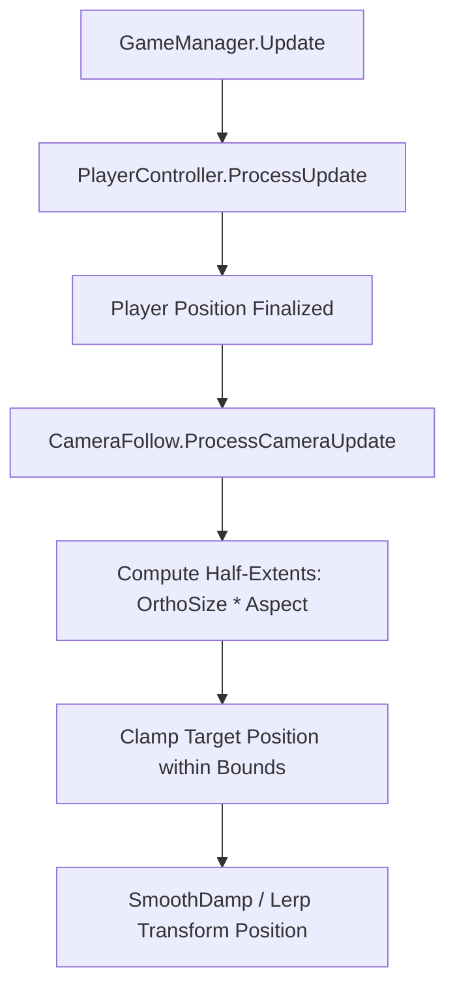

# Camera Module Documentation

> **Namespace:** `Contrast.Camera`  
> **Status:** Confirmed from Source

---

## Responsibility
The **Camera** module handles 2D orthographic tracking of the player character, viewport smoothing, and spatial clamping within the level's defined camera boundaries (`CameraBoundaryData`).

---

## Main Files
- [CameraFollow.cs](file:///y:/Contrast/My%20project/Assets/Script/Contrast/Camera/CameraFollow.cs): Controls the Main Camera's transform position, calculates viewport half-extents, clamps coordinates against level limits, and executes smooth damping.

---

## Main Classes & Components

### Classes
| Symbol | Base Class | Responsibility |
| :--- | :--- | :--- |
| `CameraFollow` | `MonoBehaviour` | Attached to the primary Unity `Camera`. Exposes boundary configuration and authoritative frame update logic via `ProcessCameraUpdate()`. |

### Important Fields & Properties
- `target` (`Transform`): Transform of the player character being tracked.
- `smoothTime` / `smoothSpeed` (`float`): Damping coefficient for camera interpolation.
- `offset` (`Vector3`): Positional offset applied to target coordinates (typically $(0, 0, -10)$ to maintain 2D clipping planes).
- `hasBounds` (`bool`): Flag indicating if boundary clamping is active.
- `boundsMin` (`Vector2`): Bottom-left coordinate of the level boundary.
- `boundsMax` (`Vector2`): Top-right coordinate of the level boundary.

---

## Execution Flow & Viewport Clamping

Unlike standard Unity scripts that rely on `LateUpdate()`, `CameraFollow` is driven explicitly by `GameManager.Update()` after player movement is fully resolved:

### Viewport Half-Extent Calculation
To prevent the camera view from revealing empty space outside the boundary:
$$\text{HalfHeight} = \text{Camera.orthographicSize}$$
$$\text{HalfWidth} = \text{HalfHeight} \times \text{Camera.aspect}$$

The clamped center $(X_c, Y_c)$ satisfies:
$$\text{boundsMin.x} + \text{HalfWidth} \le X_c \le \text{boundsMax.x} - \text{HalfWidth}$$
$$\text{boundsMin.y} + \text{HalfHeight} \le Y_c \le \text{boundsMax.y} - \text{HalfHeight}$$

If the boundary size is smaller than the camera viewport, the camera is locked to the center of the boundary box.

---

## State Ownership & Integration
- The Main Camera owns the `CameraFollow` component.
- Level loading code in [LevelLoader](file:///y:/Contrast/My%20project/Assets/Script/Contrast/Level/LevelLoader.cs) reads `cameraBoundary` from `LevelData` and calls `CameraFollow.SetBounds(min, max)`.
- When the player is spawned, `CameraFollow.SetTarget(player.transform)` is called, optionally snapping immediately without smoothing to prevent initial lerp artifacts.

---

## Important Invariants
1. **Explicit Pump Invariant:** Camera positioning must only be evaluated via `ProcessCameraUpdate()` called from `GameManager.Update()`. Calling it asynchronously in `Update()` or `LateUpdate()` produces jitter against platform rider integration.
2. **Preserve Z-Distance:** The camera's $Z$ position must remain $-10$ (or configured negative distance) to ensure all 2D sprites remain between the near and far clipping planes.

---

## Related Modules
- [Core Module](Core.md): Drives `ProcessCameraUpdate()` in update loop.
- [LevelData Module](LevelData.md): Defines `CameraBoundaryData`.
- [Player Module](Player.md): Provides the tracking target.

---

## Related Documentation
- [03_RUNTIME_FLOW.md](../03_RUNTIME_FLOW.md): Execution timing in main loop.
- [06_SCENE_AND_HIERARCHY.md](../06_SCENE_AND_HIERARCHY.md): Main Camera setup.
- [INVARIANTS.md](../INVARIANTS.md): Single update loop rules.
