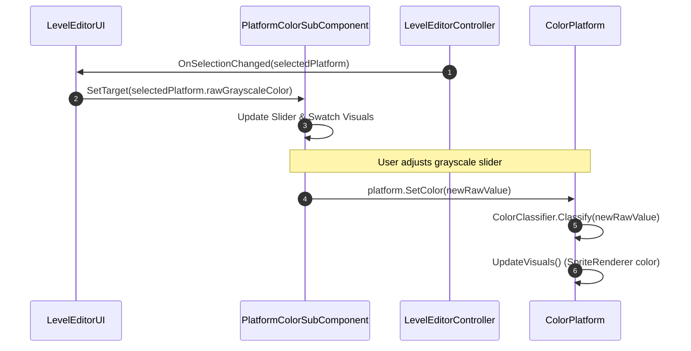

# EditorUI Module Documentation

> **Namespace:** `Contrast.UI`  
> **Status:** Confirmed from Source

---

## Responsibility
The **EditorUI** module provides the graphical user interface elements for authoring levels inside the game. All UI controls (buttons, input fields, sliders, dropdowns, and inspectors) are constructed procedurally in C# via `UnityEngine.UI` components, eliminating any reliance on pre-authored Unity UI prefabs.

---

## Main Files
- [LevelEditorUI.cs](file:///y:/Contrast/My%20project/Assets/Script/Contrast/UI/LevelEditorUI.cs): Core editor UI orchestrator; generates the main Canvas, toolbar, inspector panels, trajectory settings, and file I/O dialogs.
- [PlatformColorSubComponent.cs](file:///y:/Contrast/My%20project/Assets/Script/Contrast/UI/PlatformColorSubComponent.cs): Specialized inspector sub-widget providing continuous slider and discrete button selection for platform and marker grayscale colors.
- [LevelEditorPaletteItem.cs](file:///y:/Contrast/My%20project/Assets/Script/Contrast/UI/LevelEditorPaletteItem.cs): UI palette item allowing instantiation of platforms and markers into the scene.

---

## Main Classes & Subcomponents

### Classes
| Symbol | Base Class | Responsibility |
| :--- | :--- | :--- |
| `LevelEditorUI` | `MonoBehaviour` | Builds and manages the editor HUD, top action bar (Save/Load/Play/Back), right inspector panel, and event binding to `LevelEditorController`. |
| `PlatformColorSubComponent` | `MonoBehaviour` | Handles color editing inputs: raw grayscale float slider ($0..255$), quick-select buttons for White ($0$), Gray ($127$), Black ($212$), and Universal ($255$), and visual swatch updates. |
| `LevelEditorPaletteItem` | `MonoBehaviour` | Represents clickable palette buttons to create new game entities at runtime. |

---

## UI Layout Hierarchy & Procedural Construction
```
Canvas (Overlay)
├── TopBar
│   ├── LevelNameInput (InputField)
│   ├── SaveButton (Button)
│   ├── LoadButton (Button)
│   ├── PlayTestButton (Button)
│   └── ExitButton (Button)
├── LeftPanel (Palette)
│   ├── CreatePlatformButton
│   ├── CreateCheckpointButton
│   └── CameraBoundaryButton
└── RightPanel (Inspector)
    ├── TransformSection (PosX, PosY, SizeX, SizeY)
    ├── ColorSection (PlatformColorSubComponent)
    │   ├── GrayscaleSlider (0..255)
    │   ├── QuickPresetButtons (White, Gray, Black, Universal)
    │   └── ColorSwatchImage
    └── TrajectorySection
        ├── EnabledToggle (Toggle)
        ├── CurveTypeDropdown (Line, Circle)
        ├── DomainModeDropdown (ParameterRange, SpatialBounds)
        ├── PlaybackModeDropdown (Loop, PingPong, Once)
        ├── OriginInputs (X, Y)
        ├── DimensionInputs (Scale / Radius)
        ├── DurationInput (Seconds)
        └── ReverseToggle (Toggle)
```

---

## Runtime Binding & Event Flow



---

## State Ownership
- `LevelEditorUI` does not store canonical level data; it acts as a two-way view model binding between the user's input widgets and the active `GameObject` components (`ColorPlatform`, `LevelMarker`, `Trajectory`).
- All inputs immediately apply their mutations to the selected scene object.

---

## Important Invariants
1. **Procedural Instantiation:** All UI components are generated in code without asset prefab dependencies.
2. **Immediate Synchronization:** Modifying an input field immediately writes to the target component and updates its visual representation in the scene.
3. **Null-Safe Deselection:** When no object is selected, inspector panels must clear or hide their controls without throwing `NullReferenceException`.

---

## Related Modules
- [LevelEditor Module](LevelEditor.md): Controller executing actions triggered by `LevelEditorUI`.
- [Color Module](Color.md): Provides color classifications displayed by `PlatformColorSubComponent`.
- [LevelData Module](LevelData.md): Data schema reflected in the inspector fields.

---

## Related Documentation
- [07_EDITOR_ARCHITECTURE.md](../07_EDITOR_ARCHITECTURE.md): Editor UI and controller interactions.
- [LEVEL_EDITOR_DEVELOPER_GUIDE.md](../LEVEL_EDITOR_DEVELOPER_GUIDE.md): Developer architecture of the editor.
- [LEVEL_EDITOR_USER_GUIDE.md](../LEVEL_EDITOR_USER_GUIDE.md): User-facing instructions for UI panels.
