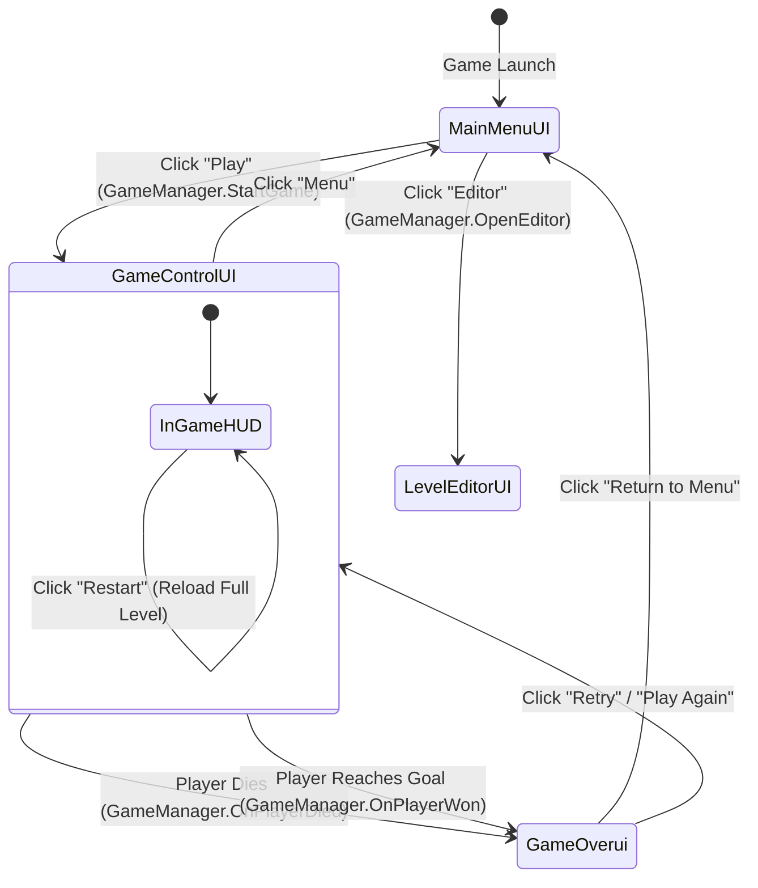

# GameUI Module Documentation

> **Namespace:** `Contrast.UI`  
> **Status:** Confirmed from Source

---

## Responsibility
The **GameUI** module manages all player-facing menus, HUD overlays, pause/control panels, and game-over/victory popups during standard gameplay. Like the editor UI, all game UI elements are instantiated programmatically at runtime using standard Unity UI primitives.

---

## Main Files
- [MainMenuUI.cs](file:///y:/Contrast/My%20project/Assets/Script/Contrast/UI/MainMenuUI.cs): Renders the title screen with options to start the game, launch the Level Editor, or exit.
- [GameOverui.cs](file:///y:/Contrast/My%20project/Assets/Script/Contrast/UI/GameOverui.cs): Modal screen displayed upon player death (`GameState.GameOver`) or level completion (`GameState.Won`), providing retry and menu navigation buttons.
- [GameControlUI.cs](file:///y:/Contrast/My%20project/Assets/Script/Contrast/UI/GameControlUI.cs): In-game HUD providing persistent quick-access buttons for Retry, Restart, and Return to Menu.

---

## Main Classes & Components

### Classes
| Symbol | Base Class | Responsibility |
| :--- | :--- | :--- |
| `MainMenuUI` | `MonoBehaviour` | Displays main menu buttons. Coordinates transitions with `GameManager`. |
| `GameOverui` | `MonoBehaviour` | Displays contextual death/win banners and offers restart/retry/menu buttons. |
| `GameControlUI` | `MonoBehaviour` | Persistent in-game HUD overlay for player controls and quick reset. |

---

## UI Flow & State Transitions

---

## State Ownership & Integration
- Game UI components hold references to `GameManager.Instance`.
- When action buttons are clicked, UI controllers directly invoke state transition methods on `GameManager`:
  - `GameManager.Instance.StartGame()`
  - `GameManager.Instance.OpenEditor()`
  - `GameManager.Instance.Restart()`
  - `GameManager.Instance.Retry()`
  - `GameManager.Instance.ReturnToMainMenu()`
- The UI contains no gameplay state; it purely reflects the active `GameState` and exposes actions.

---

## Important Invariants
1. **Dangling Scene Script Note:** Historical scene hierarchy in `SampleScene.unity` had a missing script reference on `GameSystems` where a deleted monolithic `UIManager` previously resided. The current codebase uses separate `MainMenuUI`, `GameOverui`, and `GameControlUI` components created or bound dynamically.
2. **Single Active Canvas:** When transitioning states, inactive UI canvases are deactivated via `gameObject.SetActive(false)` to prevent raycast interception and input leakage.

---

## Related Modules
- [Core Module](Core.md): Manages `GameState` transitions triggering UI changes.
- [LevelRuntime Module](LevelRuntime.md): Provides retry and restart endpoints invoked by UI buttons.

---

## Related Documentation
- [03_RUNTIME_FLOW.md](../03_RUNTIME_FLOW.md): Complete game lifecycle.
- [06_SCENE_AND_HIERARCHY.md](../06_SCENE_AND_HIERARCHY.md): UI GameObjects in scene.
- [INVARIANTS.md](../INVARIANTS.md): Architectural safety rules.
