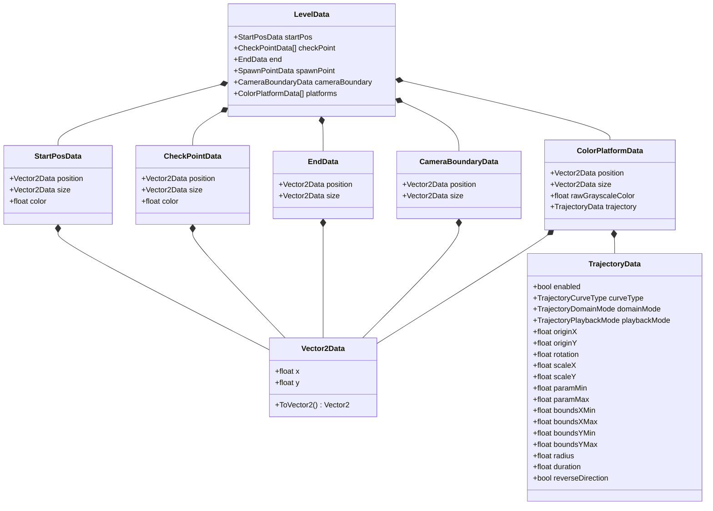

# LevelData Module Documentation

> **Namespace:** `Contrast.Data`  
> **Status:** Confirmed from Source

---

## Responsibility
The **LevelData** module defines the schema and pure data transfer objects (DTOs) used for level persistence, in-memory representation, and interchange between the runtime gameplay systems and the in-game Level Editor. It contains no gameplay logic or Unity lifecycle handlers (`MonoBehaviour`); all classes are marked `[System.Serializable]` for compatibility with `UnityEngine.JsonUtility`.

---

## Main Files
- [LevelData.cs](file:///y:/Contrast/My%20project/Assets/Script/Contrast/Data/LevelData.cs): Defines the root level document schema, spawn point data, checkpoint data, victory endpoint data, platform data, camera boundary data, and 2D vector serializable representations.
- [TrajectoryData.cs](file:///y:/Contrast/My%20project/Assets/Script/Contrast/Data/TrajectoryData.cs): Defines the parametric trajectory configuration schema, curve type enums, domain bounding modes, and playback modes.

---

## Main Classes, Structs & Enums

### Classes & Structs
| Symbol | Type | Description |
| :--- | :--- | :--- |
| `LevelData` | Class (`[System.Serializable]`) | Root container for an entire level file. Contains `startPos`, `checkPoint`, `end`, `spawnPoint`, `cameraBoundary`, and `platforms`. |
| `StartPosData` | Class (`[System.Serializable]`) | Primary player initial spawn point: `position` (`Vector2Data`), `size` (`Vector2Data`), `color` (`float`). |
| `CheckPointData` | Class (`[System.Serializable]`) | Sequential checkpoint zone: `position` (`Vector2Data`), `size` (`Vector2Data`), `color` (`float`). |
| `EndData` | Class (`[System.Serializable]`) | Level completion trigger zone: `position` (`Vector2Data`), `size` (`Vector2Data`). |
| `SpawnPointData` | Class (`[System.Serializable]`) | Legacy fallback spawn configuration: `position`, `color`, `initialPlayerColor`. |
| `ColorPlatformData` | Class (`[System.Serializable]`) | Platform definition: `position` (`Vector2Data`), `size` (`Vector2Data`), `rawGrayscaleColor` (`float`), `trajectory` (`TrajectoryData`). |
| `CameraBoundaryData` | Class (`[System.Serializable]`) | Orthographic camera clamping zone: `position` (`Vector2Data`), `size` (`Vector2Data`). |
| `Vector2Data` | Class (`[System.Serializable]`) | Serializable 2D coordinate container with `x`, `y` and conversion method `ToVector2()`. |
| `TrajectoryData` | Class (`[System.Serializable]`) | Complete parametric path configuration container. Includes factory `CreateDefault()` and `Clone()`. |

### Enums
| Enum | Underlying Type | Values | Description |
| :--- | :--- | :--- | :--- |
| `TrajectoryCurveType` | `int` | `Line = 0`, `Circle = 1` | Parametric curve family selector. |
| `TrajectoryDomainMode` | `int` | `ParameterRange = 0`, `SpatialBounds = 1` | Bounds definition (parameter sweep vs AABB clipping). |
| `TrajectoryPlaybackMode` | `int` | `Loop = 0`, `PingPong = 1`, `Once = 2` | Evaluation timing along trajectory domain. |

---

## Entry Points
- Serialization Entry: `JsonUtility.ToJson(levelData, prettyPrint: true)` executed in [LevelLoader.SaveLevel()](file:///y:/Contrast/My%20project/Assets/Script/Contrast/Level/LevelLoader.cs) or [LevelEditorController.ExportLevelData()](file:///y:/Contrast/My%20project/Assets/Script/Contrast/Level/LevelEditorController.cs).
- Deserialization Entry: `JsonUtility.FromJson<LevelData>(jsonText)` executed in [LevelLoader.LoadLevelData()](file:///y:/Contrast/My%20project/Assets/Script/Contrast/Level/LevelLoader.cs).

---

## Data Schema & Relationships

---

## Runtime Flow
1. **Level Loading:** [LevelLoader](file:///y:/Contrast/My%20project/Assets/Script/Contrast/Level/LevelLoader.cs) reads raw JSON from `Assets/Levels/<levelName>.json` or `TextAsset`.
2. **Parsing:** Parses the JSON via `JsonUtility.FromJson<LevelData>()`.
3. **Hierarchy Construction:** Spawns GameObjects:
   - `startPos` -> Spawns [LevelMarker](file:///y:/Contrast/My%20project/Assets/Script/Contrast/Level/LevelMarker.cs) (`MarkerType.Start`).
   - `checkPoint` -> Spawns [LevelMarker](file:///y:/Contrast/My%20project/Assets/Script/Contrast/Level/LevelMarker.cs) (`MarkerType.Checkpoint`).
   - `end` -> Spawns [LevelMarker](file:///y:/Contrast/My%20project/Assets/Script/Contrast/Level/LevelMarker.cs) (`MarkerType.End`).
   - `cameraBoundary` -> Configures [CameraFollow](file:///y:/Contrast/My%20project/Assets/Script/Contrast/Camera/CameraFollow.cs).
   - `platforms` -> Spawns [ColorPlatform](file:///y:/Contrast/My%20project/Assets/Script/Contrast/Level/ColorPlatform.cs) instances and attaches [Trajectory](file:///y:/Contrast/My%20project/Assets/Script/Contrast/Level/Trajectory.cs) if `trajectory != null && trajectory.enabled`.

---

## Editor Flow
1. **Live State Inspection:** When an object is selected in [LevelEditorController](file:///y:/Contrast/My%20project/Assets/Script/Contrast/Level/LevelEditorController.cs), the inspector UI reads the corresponding DTO values.
2. **Export Synthesis:** When exporting (`SaveLevel` or `PlayTest`):
   - `LevelEditorController.ExportLevelData()` constructs a new `LevelData` DTO.
   - For moving platforms, the exported `position` is computed via `Trajectory.GetInitialPosition(trajData)` rather than current animated transform position, preserving the rest position.

---

## State Ownership
- `LevelData` is a transient value container.
- During Edit Mode, the authoritative state resides in the live scene GameObjects and their components (`ColorPlatform`, `LevelMarker`, `Trajectory`).
- During Play Mode, runtime state is distributed across active components.

---

## Important Invariants
1. **Position Export Invariant:** A moving platform's JSON `position` must equal its evaluation at $t=0$ (`Trajectory.GetInitialPosition()`). Exporting animated transform coordinates causes permanent phase drift.
2. **Backward Compatibility:** Older levels omitting `trajectory` deserialize `trajectory` as `null`, which must remain treated as a stationary platform.
3. **Start Position Fallback:** If `startPos == null`, `LevelLoader` must fallback to `spawnPoint`.

---

## Related Modules
- [LevelRuntime Module](LevelRuntime.md): Consumes `LevelData` to instantiate scene objects.
- [Trajectory Module](Trajectory.md): Executes the kinematic math specified by `TrajectoryData`.
- [LevelEditor Module](LevelEditor.md): Authors and exports `LevelData`.

---

## Related Documentation
- [04_DATA_MODEL.md](../04_DATA_MODEL.md): Full data schema and lifecycle.
- [INVARIANTS.md](../INVARIANTS.md): Project architectural rules.
