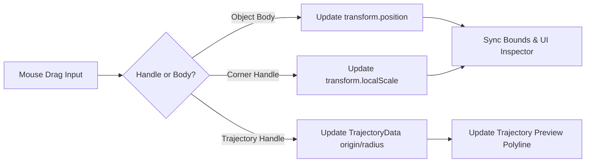

# LevelEditor Module Documentation

> **Namespace:** `Contrast.Level`  
> **Status:** Confirmed from Source

---

## Responsibility
The **LevelEditor** module provides the in-game level authoring, manipulation, inspection, trajectory configuring, and testing framework. It enables real-time scene editing, handle dragging, property binding, camera panning/zooming, and export/import of `LevelData` JSON files.

---

## Main Files
- [LevelEditorController.cs](file:///y:/Contrast/My%20project/Assets/Script/Contrast/Level/LevelEditorController.cs): Core editor controller managing mouse input, object selection, transform dragging, handle manipulation, trajectory preview, and level serialization.
- [LevelEditorUI.cs](file:///y:/Contrast/My%20project/Assets/Script/Contrast/UI/LevelEditorUI.cs): Procedural UI layout for the level editor toolbar, property panels, and palette.

---

## Main Classes & State Machines

### Classes
| Symbol | Base Class | Responsibility |
| :--- | :--- | :--- |
| `LevelEditorController` | `MonoBehaviour` | Orchestrates editor mode, input processing, handle interaction, selection highlights, camera manipulation, and test play transitions. |

### Internal States & Interaction Modes
- **Selection State:** Holds a reference to the active `GameObject` (`ColorPlatform`, `LevelMarker`, or Camera Boundary gizmo).
- **Drag Target:** Identifies whether the user is dragging:
  - The entire object (position update).
  - A scale corner handle (width/height update).
  - A trajectory origin handle.
  - A trajectory scale/radius handle.
- **Camera Pan Mode:** Initiated via middle mouse click or right-click drag; modifies the editor camera's orthographic position and size.

---

## Editor Operations & Workflows

### 1. Object Selection & Deselection
- **Mouse Down (Left Button):** Raycasts into 2D scene at mouse cursor.
  - If a selectable object (`ColorPlatform`, `LevelMarker`) is hit, `Select(hitObject)` is invoked.
  - If clicking in empty space, `Deselect()` is called unless interacting with an on-screen UI panel.
- **Selection Notification:** Triggers `LevelEditorUI.OnSelectionChanged(selectedObject)`, updating the inspector panel with live properties.

### 2. Platform & Marker Creation
- **New Platform:** Instantiates a default 1x1 platform at world coordinates (or camera center), assigns default grayscale color (255 - Universal/White), and registers with active level hierarchy.
- **New Checkpoint:** Instantiates a new `LevelMarker` (`MarkerType.Checkpoint`).
- **Deletion:** Pressing `Delete` destroys the selected platform or checkpoint. Start and End markers are protected from deletion to preserve level solvability.

### 3. Transform & Handle Manipulation

### 4. Trajectory Preview System
- In edit mode, when a platform with an enabled trajectory is selected, `LevelEditorController` samples points via `Trajectory.SampleCurve()` and renders a polyline path.
- Users can toggle **Trajectory Preview Mode**, which activates `Trajectory.Advance()` in edit mode so designers can visually inspect moving platform timings without launching play mode.

### 5. Playtesting & Export
- **Exporting:** Calls `ExportLevelData()`. For all platforms with `Trajectory`, it calculates `Trajectory.GetInitialPosition(data)` to ensure the rest position is exported, not the current animated position.
- **Playtest:** Calls `GameManager.Instance.StartGameWithLevelData(exportedData)`, instantly loading the authored level into runtime mode for immediate gameplay validation.
- **Return to Editor:** From playtest, pressing `Escape` or editor button returns directly to the editor with the authored level preserved.

---

## State Ownership
- `LevelEditorController` owns the selection state and editor camera viewport state.
- Component data resides directly on scene GameObjects (`ColorPlatform`, `LevelMarker`, `Trajectory`).
- The editor does not maintain a parallel scene representation; it edits the live scene directly.

---

## Important Invariants
1. **Initial Position Export Contract:** Always export `Trajectory.GetInitialPosition(trajData)` to `platform.position` on export.
2. **Immutable Start & End:** Start spawn and Victory end markers cannot be deleted from the scene.
3. **Player Disabling:** During edit mode, `PlayerController` GameObject must remain deactivated to avoid gravity fall or collision queries.

---

## Related Modules
- [EditorUI Module](EditorUI.md): Provides UI controls and binds to `LevelEditorController`.
- [LevelData Module](LevelData.md): Data schema exported and imported.
- [LevelRuntime Module](LevelRuntime.md): Instantiates and manages edited components.
- [Trajectory Module](Trajectory.md): Kinematic paths previewed in the editor.

---

## Related Documentation
- [07_EDITOR_ARCHITECTURE.md](../07_EDITOR_ARCHITECTURE.md): Architectural analysis of the editor.
- [LEVEL_EDITOR_DEVELOPER_GUIDE.md](../LEVEL_EDITOR_DEVELOPER_GUIDE.md): Deep-dive into editor mechanics.
- [LEVEL_EDITOR_USER_GUIDE.md](../LEVEL_EDITOR_USER_GUIDE.md): Operational guide for level designers.
