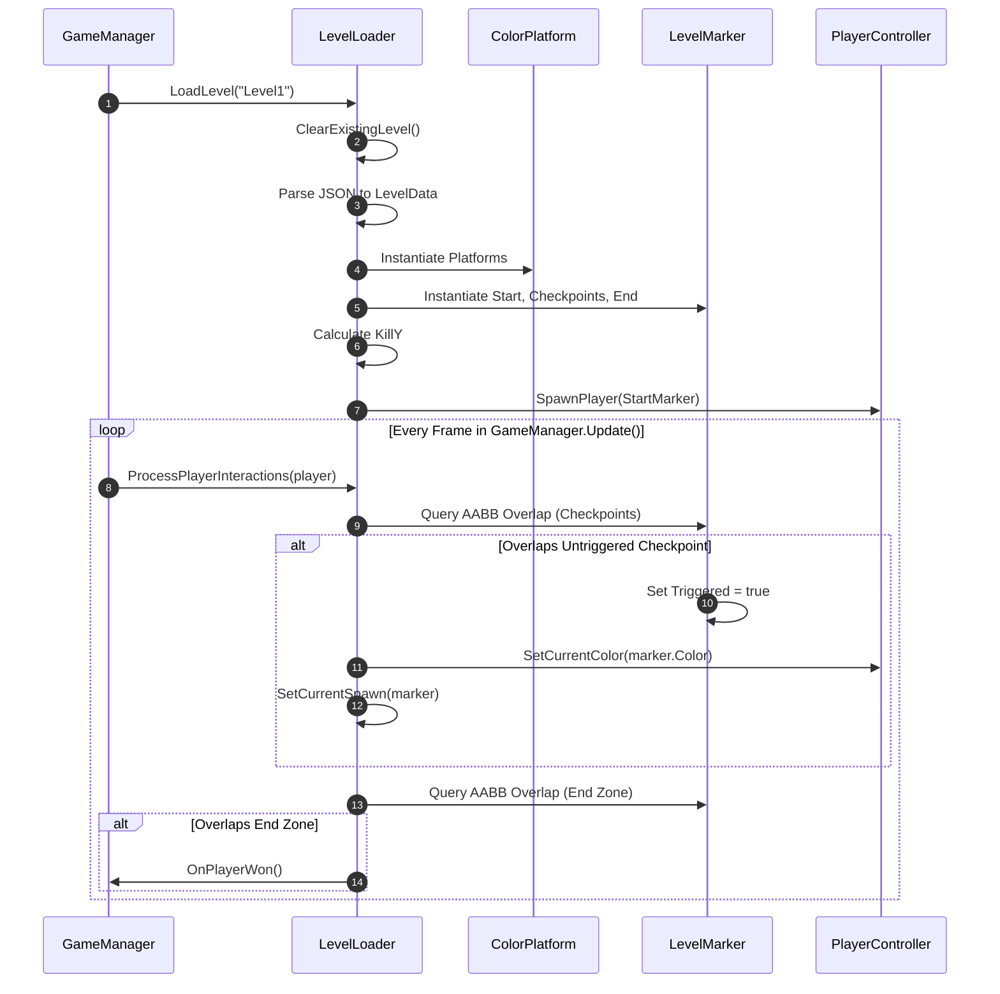

# LevelRuntime Module Documentation

> **Namespace:** `Contrast.Level`  
> **Status:** Confirmed from Source

---

## Responsibility
The **LevelRuntime** module manages the instantiation, lifecycle, spatial queries, and player interactions for all physical level elements. This includes platforms (`ColorPlatform`), functional boundary markers and triggers (`LevelMarker`), and the central scene orchestrator (`LevelLoader`).

---

## Main Files
- [ColorPlatform.cs](file:///y:/Contrast/My%20project/Assets/Script/Contrast/Level/ColorPlatform.cs): Runtime representation of static and dynamic color-responsive platforms.
- [LevelMarker.cs](file:///y:/Contrast/My%20project/Assets/Script/Contrast/Level/LevelMarker.cs): Runtime representation of spawn points, sequential checkpoints, and victory end zones.
- [LevelLoader.cs](file:///y:/Contrast/My%20project/Assets/Script/Contrast/Level/LevelLoader.cs): Spawns level geometry from `LevelData`, manages spatial registries, computes the dynamic kill floor (`KillY`), and executes AABB player interaction detection.

---

## Main Classes, Structs & Enums

### Classes
| Symbol | Base Class | Responsibility |
| :--- | :--- | :--- |
| `ColorPlatform` | `MonoBehaviour` | Represents an individual platform. Stores `rawGrayscaleColor`, computes `LogicalColor`, maintains an axis-aligned bounding box, and exposes visual rendering updates. |
| `LevelMarker` | `MonoBehaviour` | Represents start spawns, checkpoints, and level goals. Handles visual rendering (sprites/tints) and triggered states. |
| `LevelLoader` | `MonoBehaviour` | Singleton level orchestrator. Loads JSON or in-memory `LevelData`, instantiates prefabs, maintains registries of active platforms and markers, and queries interactions. |

### Enums
| Enum | Namespace | Values | Description |
| :--- | :--- | :--- | :--- |
| `MarkerType` | `Contrast.Level` | `Start = 0`, `Checkpoint = 1`, `End = 2` | Discriminates functional marker zones. |

---

## Key Properties & Spatial Registration

### `ColorPlatform`
- `RawColor` (`float`): Grayscale value in $[0, 255]$.
- `LogicalColor` (`LogicalColor`): Categorized discrete color state via `ColorClassifier.Classify(RawColor)`.
- `Bounds` (`MovementGeometry.Aabb`): World-space axis-aligned bounding box derived from `transform.position` and `transform.localScale`.
- `VisualRenderer` (`SpriteRenderer`): Cached renderer displaying the platform's classified tint.

### `LevelMarker`
- `Type` (`MarkerType`): `Start`, `Checkpoint`, or `End`.
- `RawColor` (`float`): Color value applied to the player upon spawning or touching this checkpoint.
- `IsTriggered` (`bool`): Flag indicating if this checkpoint has been activated.
- `Bounds` (`MovementGeometry.Aabb`): Trigger area bounding box.

### `LevelLoader`
- `Platforms` (`IReadOnlyList<ColorPlatform>`): Live registry of all spawned platforms in the active scene.
- `Checkpoints` (`IReadOnlyList<LevelMarker>`): Sequenced list of checkpoint markers.
- `StartMarker` (`LevelMarker`): Initial spawn point.
- `EndMarker` (`LevelMarker`): Victory goal area.
- `KillY` (`float`): Dynamic bottom boundary below which the player instantly perishes. Calculated as $\min(platform.y) - 5.0f$.

---

## Runtime Flow

---

## Editor Integration
In Edit Mode, `ColorPlatform` and `LevelMarker` components remain attached to GameObjects in the scene. `LevelEditorController` manipulates their `transform.position` and `transform.localScale` directly or through drag handles, and calls `platform.UpdateVisuals()` or `marker.UpdateVisuals()` whenever properties change.

---

## State Ownership & Lifecycle
- `LevelLoader` owns the collection of all spawned level GameObjects under a container GameObject (`_LevelRoot`).
- Calling `LevelLoader.ClearExistingLevel()` destroys all children of `_LevelRoot` and flushes internal caches.
- Platforms do NOT handle their own collisions; they are passive data providers queried by `PlayerMovementResolver` and `PlayerCollisionResolver`.

---

## Important Invariants
1. **Zero Transform Rotation:** Platforms must NEVER have rotation applied to their `Transform`. Their orientation is strictly axis-aligned ($0^\circ$).
2. **Dynamic Kill Plane:** `KillY` is recomputed dynamically based on lowest platform position on level load.
3. **Triggered Checkpoint Monotonicity:** Checkpoints activate upon player overlap and update the player's respawn coordinates and logical color.

---

## Related Modules
- [LevelData Module](LevelData.md): Data contracts loaded and saved by `LevelLoader`.
- [Trajectory Module](Trajectory.md): Drives platform movement.
- [Movement Module](Movement.md): Uses platform bounds for collision resolution.
- [Core Module](Core.md): Coordinates game lifecycle with `LevelLoader`.

---

## Related Documentation
- [03_RUNTIME_FLOW.md](../03_RUNTIME_FLOW.md): Global execution lifecycle.
- [06_SCENE_AND_HIERARCHY.md](../06_SCENE_AND_HIERARCHY.md): GameObject parent-child structures.
- [INVARIANTS.md](../INVARIANTS.md): Architectural safety constraints.
