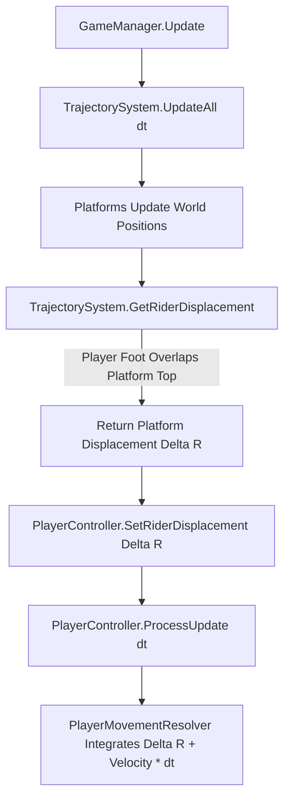

# Trajectory Module Documentation

> **Namespace:** `Contrast.Level`  
> **Status:** Confirmed from Source

---

## Responsibility
The **Trajectory** module is responsible for parametric kinematics, moving platform paths, trajectory sampling, and rider-carry kinematics (entrainment). It executes deterministic mathematical evaluations of platform positions along linear or circular paths and translates platform movement into physical rider displacement applied to the player.

---

## Main Files
- [Trajectory.cs](file:///y:/Contrast/My%20project/Assets/Script/Contrast/Level/Trajectory.cs): Attached to moving `ColorPlatform` GameObjects; evaluates instantaneous positions, velocities, and phase progressions.
- [TrajectorySystem.cs](file:///y:/Contrast/My%20project/Assets/Script/Contrast/Level/TrajectorySystem.cs): Static orchestrator that maintains an active registry of trajectories, pumps time steps in `GameManager.Update()`, and calculates rider entrainment vectors.
- [TrajectoryData.cs](file:///y:/Contrast/My%20project/Assets/Script/Contrast/Data/TrajectoryData.cs): DTO defining curve type, domains, speeds, origins, and playback modes.

---

## Main Classes, Structs & Enums

### Classes
| Symbol | Type | Responsibility |
| :--- | :--- | :--- |
| `Trajectory` | `MonoBehaviour` | Evaluates parametric curves (`Line`, `Circle`), updates platform position, computes instantaneous $\Delta \mathbf{P}$ displacement, and samples trajectory vertices for visualization. |
| `TrajectorySystem` | `static class` | Central registry for all active `Trajectory` instances in the scene. Advances kinematics synchronously and calculates rider carry displacement. |

### Kinematic Properties (`Trajectory`)
- `Data` (`TrajectoryData`): Underlying parametric configuration.
- `Phase` (`float`): Normalized evaluation parameter ($0.0 \le \text{Phase} \le 1.0$).
- `LastPosition` (`Vector2`): Platform world position from the preceding frame.
- `CurrentDisplacement` (`Vector2`): Difference $\mathbf{P}_{\text{current}} - \mathbf{P}_{\text{last}}$ during the most recent step.
- `CurrentVelocity` (`Vector2`): Estimated velocity vector $\frac{\mathbf{P}_{\text{current}} - \mathbf{P}_{\text{last}}}{\Delta t}$.

---

## Mathematical Evaluation Pipeline

### 1. Curve Evaluation (`Trajectory.Evaluate`)
Platforms move along parametric paths determined by `curveType`:
- **Line Mode (`TrajectoryCurveType.Line`):**
  $$\mathbf{P}(p) = \mathbf{Origin} + \mathbf{R}(\theta) \begin{pmatrix} p \cdot \text{scaleX} \\ 0 \end{pmatrix}$$
  where $\theta$ is `rotation` in degrees and $p$ is the parameter clamped or mapped between `paramMin` and `paramMax`.
  - When `domainMode == SpatialBounds`, the infinite line is intersected with $[ \text{boundsXMin}, \text{boundsXMax} ] \times [ \text{boundsYMin}, \text{boundsYMax} ]$.
- **Circle Mode (`TrajectoryCurveType.Circle`):**
  $$\alpha = \text{paramMin} + p \cdot (\text{paramMax} - \text{paramMin})$$
  $$\mathbf{P}(p) = \begin{pmatrix} \text{originX} + \text{radius} \cdot \cos(\alpha) \\ \text{originY} + \text{radius} \cdot \sin(\alpha) \end{pmatrix}$$

### 2. Playback Modes (`TrajectoryPlaybackMode`)
- `Loop`: Phase advances linearly $0 \to 1$ and wraps around to $0$.
- `PingPong`: Phase advances $0 \to 1$, then reverses $1 \to 0$ continuously.
- `Once`: Phase advances $0 \to 1$ and clamps at the end.

---

## Rider Entrainment (Moving Platform Carry)

To allow the player to stand on a moving platform without slipping, sliding, or jittering, rider carry is resolved prior to the player's movement step:

### Rider Detection Condition:
A player is considered "riding" a moving platform if:
1. The horizontal interval of the player overlaps the platform's horizontal interval:
   $$[x_{\text{min}}, x_{\text{max}}]_{\text{player}} \cap [x_{\text{min}}, x_{\text{max}}]_{\text{platform}} \neq \emptyset$$
2. The bottom edge of the player's AABB is resting on the platform's top edge within a vertical tolerance $\epsilon$:
   $$| y_{\text{min, player}} - y_{\text{max, platform}} | \le \epsilon$$
3. The platform's logical color matches the player's color or is `Universal`.

---

## Editor & Preview Flow
In the Level Editor, `Trajectory` provides:
1. `SampleCurve(int segmentCount)`: Generates a polyline array of `Vector3` points used by `LevelEditorController` or line renderers to draw the trajectory path in the scene view.
2. `GetInitialPosition(TrajectoryData data)`: Evaluates where the platform should rest at $t=0$. This is crucial during level save/export to ensure platforms do not serialize in an offset animated state.

---

## Important Invariants
1. **Never Rotate the Transform:** Platforms never have transform rotation applied. Curve rotation ($\theta$) is handled strictly inside `Evaluate()` math.
2. **Synchronous Execution:** `TrajectorySystem.UpdateAll()` MUST execute before `PlayerController.ProcessUpdate()`. If executed after, rider displacement lags by one frame, producing noticeable visual jitter.
3. **Rest Position Serialized:** When serializing to `LevelData`, `platform.position` must be `Trajectory.GetInitialPosition()`, never `transform.position`.

---

## Related Modules
- [LevelData Module](LevelData.md): Persists `TrajectoryData`.
- [LevelRuntime Module](LevelRuntime.md): Hosts `ColorPlatform` and `Trajectory` components.
- [Movement Module](Movement.md): Consumes rider displacement during collision resolution.
- [LevelEditor Module](LevelEditor.md): Manipulates trajectory parameters and displays preview paths.

---

## Related Documentation
- [03_RUNTIME_FLOW.md](../03_RUNTIME_FLOW.md): Order of execution during the update loop.
- [07_EDITOR_ARCHITECTURE.md](../07_EDITOR_ARCHITECTURE.md): Trajectory preview and handle editing.
- [INVARIANTS.md](../INVARIANTS.md): Invariant 1 and 2 rules.
