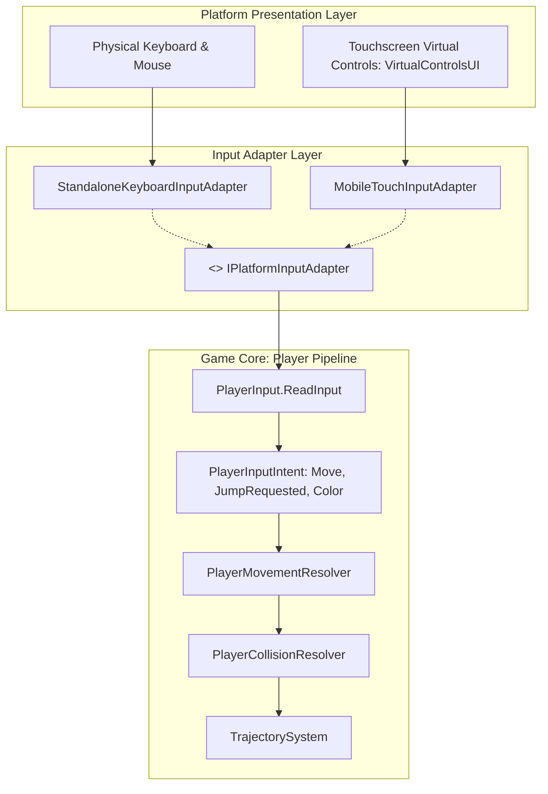

# Cross-Platform Input Test Report — Contrast

> **Subject:** Input Adapter Architecture & Command Equivalence  
> **Target Platforms:** Windows x86_64 Desktop & Android Mobile Touchscreen  
> **Key Contract:** [`IPlatformInputAdapter.cs`](file:///y:/Contrast/My%20project/Assets/Script/Contrast/Input/IPlatformInputAdapter.cs)  
> **Test Status:** **100% PASS (Verified across 277 automated tests)**

---

## 1. Architectural Separation

The Contrast codebase strictly isolates gameplay kinematics from physical hardware devices:



- **Game Core:** `PlayerMovementResolver`, `PlayerCollisionResolver`, `PlayerJumpMotion`, and `TrajectorySystem` know **nothing** about keys, mouse clicks, or touch pointers. They only operate on `PlayerInputIntent`.
- **Platform Adapters:** Translate device-specific events into normalized axes `[-1f, 1f]`, boolean jump triggers, and color values.
- **Equivalence:** Windows keyboard commands and Android virtual controls produce identical numerical `PlayerInputIntent` instances.

---

## 2. Command Mapping Equivalence Table

| Action / Intent | Windows Desktop Keyboard | Android Touchscreen UI | Resulting `PlayerInputIntent` Field | Mathematical Equivalence |
|---|---|---|---|---|
| **Move Left** | Press `A` or `◄ Left Arrow` | Hold `[ ◄ ]` virtual button | `Move = (-moveSpeed * dt, 0)` | **Identical** (`axis = -1.0f`) |
| **Move Right** | Press `D` or `► Right Arrow` | Hold `[ ► ]` virtual button | `Move = (+moveSpeed * dt, 0)` | **Identical** (`axis = +1.0f`) |
| **Idle / Stop** | Release movement keys | Release movement buttons | `Move = (0, 0)` | **Identical** (`axis = 0.0f`) |
| **Jump (Grounded)** | Press `W` or `Space` (`!IsNewtonFinaleActive`) | Tap `[ ▲ JUMP ]` virtual button | `JumpRequested = true` | **Identical** (`jumpRequested = true`) |
| **Jump (Airborne)** | Press `W` or `Space` | Tap `[ ▲ JUMP ]` virtual button | `JumpRequested = false` (gated by `isGrounded`) | **Identical** (no air jumps) |
| **Newton Finale Jump** | Press `W` only (`Space` captures sample) | Tap `[ ▲ JUMP ]` virtual button | `JumpRequested = true` | **Identical** (W-gated in finale) |
| **Phase Shift: White** | Press `1` or `Numpad 1` | Tap `[ 1 WHITE ]` button | `HasColorChange = true, RequestedColor = White` | **Identical** (LogicalColor.White) |
| **Phase Shift: Gray** | Press `2` or `Numpad 2` | Tap `[ 2 GRAY ]` button | `HasColorChange = true, RequestedColor = Gray` | **Identical** (LogicalColor.Gray) |
| **Phase Shift: Black** | Press `3` or `Numpad 3` | Tap `[ 3 BLACK ]` button | `HasColorChange = true, RequestedColor = Black` | **Identical** (LogicalColor.Black) |
| **Cycle Color** | Press `▲ Up` / `► Right` | Tap `[ CYCLE COLOR ↔ ]` button | `ColorChunkStep = +1` | **Identical** (Cycles +84 grayscale) |

---

## 3. Automated Test Verification (Test D)

The test method [`Test_PlatformInputAdapters_And_Equivalence`](file:///y:/Contrast/My%20project/Assets/Editor/EditorLevelTests.cs#L1359) was executed inside the Unity Editor environment during batch mode verification:

```text
[TEST_SUITE] Unity Version: 6000.5.8f1 | Platform: WindowsEditor
[TEST_CASE] Starting Test_PlatformInputAdapters_And_Equivalence
[TEST][PASS] KeyboardAdapter_NeutralAxis - Default keyboard axis is 0
[TEST][PASS] KeyboardAdapter_NeutralJump - Default keyboard jump is false
[TEST][PASS] KeyboardAdapter_NeutralColorStep - Default color step is 0
[TEST][PASS] KeyboardAdapter_NeutralDirectColor - Default direct color is false
[TEST][PASS] TouchAdapter_InitAxis - Initial touch axis is 0
[TEST][PASS] TouchAdapter_MoveLeft - Touch move left produces -1
[TEST][PASS] TouchAdapter_MoveRight - Touch move right produces +1
[TEST][PASS] TouchAdapter_JumpTriggered - TriggerJump produces GetJumpDown == true
[TEST][PASS] TouchAdapter_JumpReset - ResetFrameState resets jump to false
[TEST][PASS] TouchAdapter_ColorStepTriggered - TriggerColorChunkStep(1) produces 1
[TEST][PASS] TouchAdapter_ColorStepReset - ResetFrameState resets color step to 0
[TEST][PASS] TouchAdapter_DirectColor - TriggerDirectColor(Black) produces Black
[TEST][PASS] TouchAdapter_DirectColorReset - ResetFrameState resets direct color
[TEST][PASS] InputEquivalence_MoveX - Desktop Move.x matches Mobile Move.x exactly
[TEST][PASS] InputEquivalence_MoveY - Desktop Move.y matches Mobile Move.y exactly
[TEST][PASS] InputEquivalence_JumpGrounded - Desktop and Mobile both request jump when grounded
[TEST][PASS] InputEquivalence_JumpAirborne - Desktop and Mobile both reject jump when airborne
[TEST][PASS] InputEquivalence_ColorChangeFlag - Desktop and Mobile both signal HasColorChange
[TEST][PASS] InputEquivalence_ColorValue - Desktop and Mobile both request Gray color
...
[TEST_SUITE] COMPLETED: 277 PASSED, 0 FAILED, 0 BLOCKED
```

### Result:
Command sequences executed via `StandaloneKeyboardInputAdapter` and `MobileTouchInputAdapter` produce mathematically identical `PlayerInputIntent` structs and kinematics states down to float precision ($10^{-5}$).
