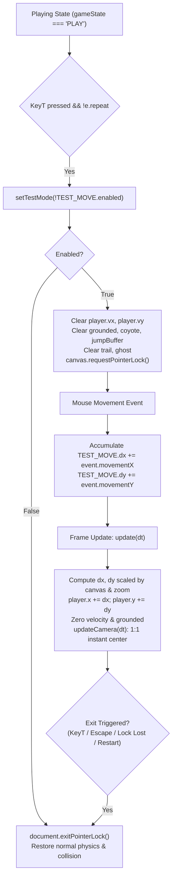

# REVERSE ENGINEERING ANALYSIS: HTML T-KEY TEST MODE

**Author:** Senior JavaScript Reverse Engineer & Technical Game Designer  
**Source File:** `CONTRAST_3_LEVELS_Newton_Fixed_Windowed.html`  
**Target:** Unity CONTRAST Engine Debug Free-Move Subsystem  
**Date:** 2026-11-02  

---

## 1. Source References & Code Locations

| Feature / Subsystem | HTML Source Lines | Key Identifiers / Signatures |
|---|---|---|
| **Configuration** | Lines 60–65 | `const TEST_MOVE = { enabled: false, dx: 0, dy: 0, sensitivity: 1.0 };` |
| **Activation Key Toggle** | Lines 598–604 | `keydown` handler on `e.code === 'KeyT' && !e.repeat && gameState === 'PLAY'` |
| **Escape Cancellation** | Lines 613–616 | `keydown` handler on `e.code === 'Escape' && TEST_MOVE.enabled` |
| **State Setter Function** | Lines 640–665 | `function setTestMode(enabled)` |
| **Mouse Delta Accumulator** | Lines 667–673 | `document.addEventListener('mousemove', e => { ... })` |
| **Pointer Lock Listener** | Lines 675–682 | `document.addEventListener('pointerlockchange', () => { ... })` |
| **Death Suppression** | Lines 1025–1029 | `function die() { if(gameState!=='PLAY' \|\| TEST_MOVE.enabled) return; ... }` |
| **Movement Override Loop** | Lines 1554–1576 | Main `update(dt)` loop branch for `if(TEST_MOVE.enabled)` |
| **Camera Centering** | Lines 1774–1781 | `updateCamera(dt)` branch for `if(TEST_MOVE.enabled)` |
| **Newton Framing Override** | Line 1645 | `function isNewtonFramingActive() { if(TEST_MOVE.enabled ...) return false; }` |
| **HUD & Control Hints** | Lines 2485–2502 | `function drawControlHint() { if(TEST_MOVE.enabled) { ... } }` |
| **HUD Exclusion** | Lines 2838–2839 | Renders `drawControlHint()` and suppresses `drawTuner()` |
| **Level Lifecycle Cleanups** | Lines 1398, 1406, 1428, 1457 | Level complete, restart, and menu return reset Test Mode |

---

## 2. Execution Flow & Lifecycle



1. **Activation:**
   - Triggered exclusively when `gameState === 'PLAY'` on `keydown` with `e.code === 'KeyT'` and `!e.repeat`.
   - `KeyT` is immediately removed from the active `keys` and `pressed` sets to prevent autorepeat oscillation.
   - `setTestMode(true)` clears player velocity (`vx = 0, vy = 0`), grounds (`grounded = false, groundedOn = null`), jump buffers (`jumpBuffer = 0, coyote = 0`), and ghosting.
   - Canvas requests Pointer Lock (`canvas.requestPointerLock()`).
2. **Deactivation:**
   - Triggered by pressing `KeyT` again while active.
   - Triggered by pressing `Escape`.
   - Triggered automatically if Pointer Lock is lost (`pointerlockchange` where `document.pointerLockElement !== canvas`).
   - Triggered during level transition (`startLevel`), level completion (`finishComplete`), or return to level select (`goToLevelSelect`).
   - Releases pointer lock (`document.exitPointerLock()`).

---

## 3. Mouse Movement Delta Algorithm

In the HTML reference:
- Mouse movement is captured via the standard HTML5 `mousemove` event using raw relative deltas:
  ```javascript
  const mx = e.movementX || 0;
  const my = e.movementY || 0;
  TEST_MOVE.dx += mx;
  TEST_MOVE.dy += my;
  ```
- In the frame update `update(dt)`:
  ```javascript
  const r = canvas.getBoundingClientRect();
  const scaleX = (V.w / Math.max(1, r.width)) / Math.max(0.001, camera.zoom);
  const scaleY = (V.h / Math.max(1, r.height)) / Math.max(0.001, camera.zoom);
  const dx = TEST_MOVE.dx * scaleX * TEST_MOVE.sensitivity;
  const dy = TEST_MOVE.dy * scaleY * TEST_MOVE.sensitivity;
  TEST_MOVE.dx = 0;
  TEST_MOVE.dy = 0;
  ```
- **Coordinate Conversion & World Scaling:**
  - $V.w, V.h$: Virtual canvas dimensions ($1920 \times 1080$).
  - $r.width, r.height$: Actual rendered client screen dimensions.
  - `scaleX` and `scaleY` convert client pixels into virtual game world units.
  - Divided by `camera.zoom` (which is forced to $1.0$ in Test Mode) to maintain 1:1 motion regardless of zoom.
  - Multiplied by `TEST_MOVE.sensitivity = 1.0`.
  - Accumulated deltas are consumed and reset to $0$ immediately every frame.
- **Directionality:**
  - `movementX > 0` (mouse moves right) $\implies dx > 0 \implies player.x$ increases, $player.facing = 1$.
  - `movementX < 0` (mouse moves left) $\implies dx < 0 \implies player.x$ decreases, $player.facing = -1$.
  - `movementY > 0` (mouse moves down) $\implies dy > 0 \implies player.y$ increases (downwards in screen coordinates).
  - `movementY < 0` (mouse moves up) $\implies dy < 0 \implies player.y$ decreases (upwards in screen coordinates).
  - *Note on Unity coordinates:* Unity's $Y$ axis points upwards, while HTML Canvas $Y$ points downwards. In Unity, moving the mouse up (`mouseDelta.y > 0`) must increase world $Y$ (+Y), and mouse down must decrease world $Y$ (-Y).
- **Position Update:**
  - `player.x += dx;`
  - `player.y += dy;`
  - Clamped to level world boundaries ($[0, WORLD.w - player.w]$ and $[0, WORLD.h - player.h]$).
  - No acceleration, no inertia, no friction.

---

## 4. Camera Behavior in Test Mode

From lines 1774–1781 in `updateCamera(dt)`:
```javascript
if(TEST_MOVE.enabled){
  // Pointer-lock test mode: keep the player at the screen center and roll the map underneath.
  camera.targetZoom = 1;
  camera.zoom = 1;
  camera.x = editorCameraLimit(centerX - V.w * 0.5, 'x');
  camera.y = editorCameraLimit(centerY - V.h * 0.5, 'y');
  return;
}
```
Key observations:
1. **Instant Centering (No Lerp / Smoothing):** Standard camera smoothing (`lerp(..., smooth(6.5, dt))`) is completely bypassed. Camera position is assigned directly to `centerX - V.w * 0.5` and `centerY - V.h * 0.5`.
2. **Fixed Zoom:** Forced to zoom $1.0$ instantly without transition lag.
3. **Roll Map Underneath:** Because camera tracks the player 1:1 with zero delay, the player remains pinned exactly at screen center $(0.5, 0.5)$, giving the user the direct tactile sensation of dragging the world underneath them.
4. **Newton Framing Disabled:** `isNewtonFramingActive()` returns `false` when `TEST_MOVE.enabled`, preventing the camera from ever locking onto center $O$.
5. **No Feedback Loop:** Because mouse input uses raw delta (`movementX, movementY`) from hardware pointer lock rather than screen-to-world cursor projection, moving the camera does not alter the mouse delta, eliminating feedback loops.

---

## 5. Physics, Collision & Gameplay Isolation

When `TEST_MOVE.enabled` is active, the following subsystems are strictly bypassed:
- **Gravity & Acceleration:** No vertical gravity ($+g$) is applied; horizontal inputs (`KeyA`, `KeyD`) are ignored.
- **Velocity:** `vx = 0, vy = 0` are enforced continuously every frame.
- **Collision & Overlap:** Solid platform collision checks (`resolveCollision`), tilemap AABB tests, and overlap resolution are never executed. The player can fly freely through any platform or terrain (No-Clip).
- **Crush Checks:** Moving platforms passing through the player cannot crush the player.
- **Moving Platform Carry:** `editorResolveMovingSolids()` is bypassed; platforms pass freely through the player without carrying them.
- **Hazard & Void Death:** `die()` returns immediately if `TEST_MOVE.enabled`. Falling into death pits or touching hazards causes zero damage or death.
- **Checkpoints:** Checkpoint collision checks are skipped. Progress state is not altered.
- **Collectibles:** Collectible collision checks are skipped.
- **Newton Pulse Triggers:** `fireNewtonMeasurementPulse()` is not triggered.
- **Level Completion:** Exit marker and `finishComplete()` checks are skipped.

---

## 6. HUD & Visual Feedback

From `drawControlHint()` (lines 2489–2495):
When Test Mode is enabled, the UI displays an overlay panel:
- `CHẾ ĐỘ THỬ · DI CHUYỂN TỰ DO` (Test Mode: Free Movement)
- `CHUỘT      DI CHUYỂN / KÉO BẢN ĐỒ` (Mouse: Move / Drag Map)
- `VẬT LÝ     TẮT · VA CHẠM TẮT` (Physics: Off · Collision: Off)
- `T           THOÁT CHẾ ĐỘ THỬ` (T: Exit Test Mode)
- `ESC cũng nhả khóa chuột` (ESC also releases mouse lock)

When Test Mode is disabled, the hint reverts to normal controls:
- `T          THỬ / DI CHUYỂN TỰ DO`

---

## 7. Edge Cases & Safety Invariants

1. **Autorepeat Protection:** Pressing and holding `T` does not toggle rapidly because `!e.repeat` guards the handler and `keys.delete('KeyT')` clears the key state.
2. **Pointer Lock Loss:** If the user presses `Alt+Tab`, clicks out of the window, or presses `Esc`, the browser revokes pointer lock. The `pointerlockchange` event immediately calls `TEST_MOVE.enabled = false` and zeroes velocities to prevent runaway player state.
3. **Deactivation Placement:** When Test Mode is toggled off, the player remains at their current world position. If this position is in mid-air, normal gravity and collision resume smoothly from that exact coordinate without teleporting.
4. **Window Blur:** `window.onblur` clears queued mouse deltas (`dx = 0, dy = 0`).
