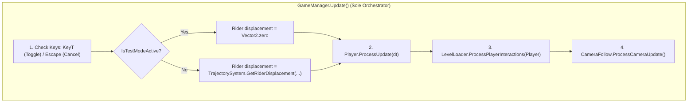

# UNITY T-KEY TEST MODE INTEGRATION PLAN

**Author:** Senior Unity C# Gameplay Engineer & Game Architect  
**Project:** CONTRAST (Unity 6000.5.8f1)  
**Reference Document:** `Reports/Debug/HTML_T_MODE_ANALYSIS.md`  
**Date:** 2026-11-02  

---

## 1. Architectural Survey & Authority Map

| Component / File | Current Responsibility | Proposed Test Mode Role & Minimal Delta |
|---|---|---|
| **`GameManager.cs`** | Single authoritative Update loop; state manager (`GameState.Playing`, `Paused`, etc.); menu and input event router. | Detects `KeyT` press in `Playing` state to toggle Test Mode. Detects `Escape` to deactivate Test Mode and release pointer lock instead of pausing into menu. Cleans up Test Mode on level restarts, scene unloads, or focus loss. Suppresses moving platform rider carry when Test Mode is active. |
| **`PlayerController.cs`** | Authoritative player movement execution, state machine (`PlayerState`), jump motion coordination, phase tuning, and death handling. | Exposes `bool IsTestModeActive { get; }` and `void SetTestMode(bool enabled)`. In `ProcessUpdate`, when active: accumulates relative mouse delta, converts to world displacement, directly updates player position, zeroes velocity/grounding, and suppresses `Die()`. |
| **`PlayerMovementResolver.cs`** | Predictive AABB collision resolution, overlap push-out, and ground detection. | **Zero changes required.** Naturally bypassed when `PlayerController.IsTestModeActive` takes the debug branch in `ProcessUpdate()`. |
| **`PlayerCollisionResolver.cs`** | Continuous box sweep against solid platforms. | **Zero changes required.** Unaffected and untouched. |
| **`PlayerOverlapResolver.cs`** | Safe push-out and stuck detection for initial/resumed overlaps. | **Zero changes required.** When Test Mode ends, standard overlap evaluation naturally resumes to safely resolve terrain overlaps if necessary. |
| **`CameraFollow.cs`** | Tracks player position within level boundaries with mode transitions (`NormalPlatformingFollow`, `NewtonPlayerFollow`, `NewtonResultReveal`). | Adds `CameraMode.TestModeFreeMove`. In this mode, camera position instantly centers on the target player with zero smoothing delay and fixed standard orthographic size ($5.0$), rolling the world underneath without Newton center locking or boundary clamping. Restores prior mode upon exit. |
| **`LevelLoader.cs`** | Manages runtime markers (Checkpoints, End/Win triggers). | In `ProcessPlayerInteractions(PlayerController player)`, guards interaction loop with `if (player.IsTestModeActive) return;` so checkpoints and victory triggers are never consumed during debug navigation. |
| **`EasyNewtonFinaleController.cs`** | Manages K/I platform orbits, crosshairs, and measurement point captures. | In `IsNewtonMarkPressedThisFrame()` and `AttemptCapture()`, guards with `if (player != null && player.IsTestModeActive) return;` to prevent unintentional Newton marking during debug flight. |
| **`TestModeUI.cs`** (New) | Presentation overlay for Vietnamese debug instructions. | Renders minimal translucent panel displaying the 6 canonical HTML Vietnamese text lines when Test Mode is enabled. Automatically hides when disabled. |

---

## 2. Authoritative Position & Frame Pipeline Invariant

The project's architectural contract strictly forbids creating secondary Update loops or parallel state managers:



### Invariant Preservation:
1. **Single Entry Point:** Movement execution remains exclusively inside `GameManager.Update()` $\rightarrow$ `PlayerController.ProcessUpdate(deltaTime)`.
2. **No Parallel Updates:** No separate `MonoBehaviour.Update()` is added for physics or debug movement.
3. **Phase-Based Pipeline:** 
   - Hardware Input polling $\rightarrow$
   - Intent interpretation $\rightarrow$
   - Displacement computation $\rightarrow$
   - Position commit $\rightarrow$
   - Camera tracking.

---

## 3. Mouse Delta to World Displacement Mathematical Model

### A. Coordinate System Parity
- **HTML Canvas:** Top-left origin $(0, 0)$; $+X$ points right, $+Y$ points down.
  $$dx = \text{movementX} \times \left(\frac{V_w}{\text{clientWidth}}\right) \times \frac{1}{\text{zoom}} \times \text{sensitivity}$$
  $$dy = \text{movementY} \times \left(\frac{V_h}{\text{clientHeight}}\right) \times \frac{1}{\text{zoom}} \times \text{sensitivity}$$
- **Unity 2D Orthographic:** Center origin; $+X$ points right, $+Y$ points **up**.
  - Total vertical camera span in world units $= 2 \times \text{orthographicSize}$.
  - Screen height in physical pixels $= \text{Screen.height}$.
  - World units per pixel vertically:
    $$U_{\text{pixel}} = \frac{2 \times \text{cam.orthographicSize}}{\max(1, \text{Screen.height})}$$
  - Since Unity camera aspect ratio $\text{aspect} = \frac{\text{Screen.width}}{\text{Screen.height}}$, horizontal world units per pixel:
    $$\frac{2 \times \text{cam.orthographicSize} \times \text{aspect}}{\text{Screen.width}} = \frac{2 \times \text{cam.orthographicSize}}{\text{Screen.height}} = U_{\text{pixel}}$$
  - Relative mouse movement vector $\Delta_{\text{mouse}} = (\Delta x, \Delta y)$ where $\Delta x$ is positive right and $\Delta y$ is positive up.
  - Resulting world displacement vector $\vec{D}$:
    $$\vec{D} = \begin{pmatrix} \Delta x \times U_{\text{pixel}} \times \text{sensitivity} \\ \Delta y \times U_{\text{pixel}} \times \text{sensitivity} \end{pmatrix}$$

### B. Hardware Input Reading
To support both the New Input System package (`UnityEngine.InputSystem`) and Legacy Input (`UnityEngine.Input`):
```csharp
public static Vector2 ReadRawMouseDelta()
{
#if ENABLE_INPUT_SYSTEM
    if (UnityEngine.InputSystem.Mouse.current != null)
    {
        return UnityEngine.InputSystem.Mouse.current.delta.ReadValue();
    }
#endif
    return new Vector2(UnityEngine.Input.GetAxisRaw("Mouse X"), UnityEngine.Input.GetAxisRaw("Mouse Y"));
}
```
When the mouse is stationary, $\Delta_{\text{mouse}} = (0, 0)$, guaranteeing $\vec{D} = (0, 0)$ with zero drift.

---

## 4. Cursor Capture & Pointer Lock Handling

1. **On Test Mode Activation:**
   ```csharp
   Cursor.lockState = CursorLockMode.Locked;
   Cursor.visible = false;
   ```
2. **On Test Mode Deactivation (via T, Escape, Focus Loss, Level Exit):**
   ```csharp
   Cursor.lockState = CursorLockMode.None;
   Cursor.visible = true;
   ```
3. **Application Focus Loss:**
   When the user switches windows or presses `Alt+Tab`, `OnApplicationFocus(false)` deactivates Test Mode immediately to prevent stuck locked cursor or runaway state.

---

## 5. Camera Tracking Architecture

- In normal gameplay, `CameraFollow` supports smoothing and clamping to the level boundary rectangle.
- In Test Mode:
  - We activate `CameraMode.TestModeFreeMove`.
  - Camera position is assigned directly to:
    $$\text{cam.transform.position} = (\text{target.position.x}, \text{target.position.y}, \text{cam.transform.position.z})$$
  - Camera orthographic size is pinned to $5.0f$ (standard zoom).
  - Smoothing (`Lerp`) is bypassed completely.
  - Newton Chamber center lock is bypassed completely.
  - As a result, the player is locked to viewport center $(0.5, 0.5)$, and the world scrolls smoothly underneath.

---

## 6. Physics & Gameplay Interaction Isolation

While `IsTestModeActive == true`:
1. **Gravity & Fast Fall:** Bypassed (`jumpMotion.ResetMotion()`).
2. **Velocity:** Enforced $0$.
3. **Terrain Collision & Overlap:** Skipped in `PlayerController.ProcessUpdate()`.
4. **Platform Carry:** `GameManager` supplies `Vector2.zero` as `riderDisplacement`.
5. **Death & Hazards:** `PlayerController.Die()` returns immediately without executing.
6. **Checkpoints & Level End:** `LevelLoader.ProcessPlayerInteractions()` returns immediately.
7. **Newton Marking:** `EasyNewtonFinaleController.IsNewtonMarkPressedThisFrame()` returns `false`, and `AttemptCapture()` returns immediately.
8. **Phase Tuning:** Left/Right arrow keys continue to tune phase, matching HTML reference lines 1549–1552.

---

## 7. State Restoration & Safe Resume

When Test Mode is toggled off:
1. `PlayerController.SetTestMode(false)` restores `State = PlayerState.Falling` (or ground evaluation).
2. The player remains at their exact debug-positioned coordinates (no teleportation).
3. `Cursor.lockState = CursorLockMode.None`, `Cursor.visible = true`.
4. `CameraFollow` restores normal platforming or Newton follow mode.
5. In the next frame of `ProcessUpdate()`, standard collision and overlap resolution resume smoothly. If the player was placed inside solid geometry, the existing `PlayerOverlapResolver` will resolve overlap per established game rules.

---

## 8. Verification Strategy

1. **Harness Tests:** Extend `ContrastTests` and `EditorLevelTests` to programmatically verify:
   - Toggle on/off behavior and velocity clearing.
   - Mouse delta displacement calculation (all 4 directions).
   - Zero mouse delta produces zero drift.
   - Solid platform penetration (No-Clip).
   - Hazard and void death immunity.
   - Normal key suppression (WASD).
   - Interaction bypass (checkpoints, end markers, Newton marks).
   - Clean cursor lock release on Escape and focus loss.
2. **Regression Verification:** Run full test suite to guarantee 0 regressions across existing levels L01–L03.
3. **Windows Release Build:** Compile executable to `Release/Windows/Game/Game.exe` and verify.
