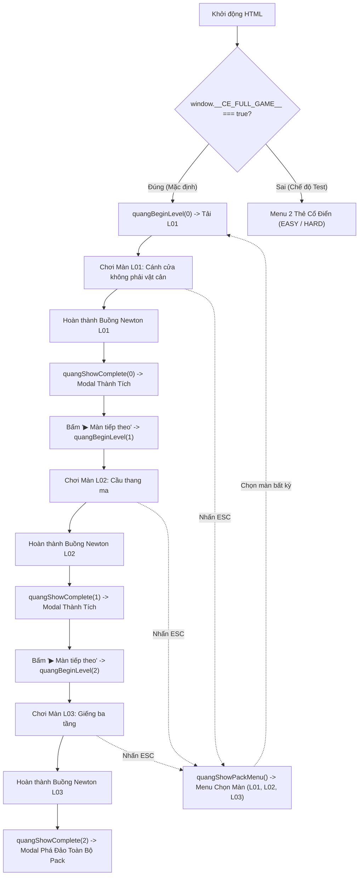

# BÁO CÁO PHÂN TÍCH VÀ ĐẢO NGƯỢC THIẾT KẾ MÀN CHƠI (HTML GAME REVERSE ENGINEERING & LEVEL ANALYSIS)

> **Tài liệu phân tích kỹ thuật hệ thống màn chơi & cơ chế gameplay tham chiếu từ mã nguồn HTML gốc.**  
> **Phiên bản tài liệu:** 1.0  
> **Mã nguồn phân tích:** `CONTRAST_3_LEVELS_Newton_Fixed_Windowed.html`  
> **Trạng thái:** CHỜ DUYỆT (AWAITING USER APPROVAL) — Chưa tạo JSON, chưa chỉnh sửa mã nguồn Unity.

---

## MỤC LỤC

1. [Phần 1 — Tóm tắt điều hành (Executive Summary)](#phần-1--tóm-tắt-điều-hành-executive-summary)
2. [Phần 2 — Danh mục kiểm kê màn chơi đầy đủ (Complete Level Inventory)](#phần-2--danh-mục-kiểm-kê-màn-chơi-đầy-đủ-complete-level-inventory)
3. [Phần 3 — Báo cáo chi tiết từng màn chơi (Detailed Level Descriptions)](#phần-3--báo-cáo-chi-tiết-từng-màn-chơi-detailed-level-descriptions)
   - [Màn L01: Cánh cửa không phải vật cản (The Door Is Not an Obstacle)](#level-l01--cánh-cửa-không-phải-vật-cản)
   - [Màn L02: Cầu thang ma (Ghost Staircase)](#level-l02--cầu-thang-ma)
   - [Màn L03: Giếng ba tầng (Three-Tier Well)](#level-l03--giếng-ba-tầng)
   - [Màn Baseline Legacy Easy: Dễ / Vừa — Bài đo A](#level-legacy-easy--dễ--vừa--bài-đo-a)
   - [Màn Baseline Legacy Hard: Khó — Bài đo B](#level-legacy-hard--khó--bài-đo-b)
4. [Phần 4 — Ma trận so sánh các màn chơi (Level Comparison Matrix)](#phần-4--ma-trận-so-sánh-các-màn-chơi-level-comparison-matrix)
5. [Phần 5 — Danh mục cơ chế Gameplay (Gameplay Mechanics Catalog)](#phần-5--danh-mục-cơ-chế-gameplay-gameplay-mechanics-catalog)
6. [Phần 6 — Tiến trình màn chơi và luồng điều hướng (Level Progression & Routing)](#phần-6--tiến-trình-màn-chơi-và-luồng-điều-hướng-level-progression--routing)
7. [Phần 7 — Các câu hỏi và điểm chưa xác định cần làm rõ (Questions and Uncertainties)](#phần-7--các-câu-hỏi-và-điểm-chưa-xác-định-cần-làm-rõ-questions-and-uncertainties)

---

## PHẦN 1 — TÓM TẮT ĐIỀU HÀNH (EXECUTIVE SUMMARY)

### 1.1. Phạm vi phân tích
Quá trình phân tích được thực hiện trên mã nguồn duy nhất của trò chơi HTML tham chiếu:
- **Tập tin:** `CONTRAST_3_LEVELS_Newton_Fixed_Windowed.html` (Dung lượng: 159,918 bytes, 3,039 dòng mã tích hợp HTML, CSS và JavaScript).
- **Cấu trúc kiến trúc gốc:** Sử dụng HTML5 Canvas 2D (`<canvas id="game">`), luồng lặp game `requestAnimationFrame`, hệ thống vật lý AABB phẳng tự chế (custom swept/AABB collision), và hệ thống quản lý tiến trình dựa trên `localStorage`.

### 1.2. Tổng số màn chơi xác định
1. **Chiến dịch chính (Active Playable Campaign Pack — `window.__CE_LEVELS__`):**
   - **Chính xác 3 màn chơi (3 Levels)** được định nghĩa tường minh (explicitly defined) thông qua cấu trúc dữ liệu JSON nhúng tại dòng 25:
     - **Màn L01:** *"Cánh cửa không phải vật cản"* (Level ID: `L01`)
     - **Màn L02:** *"Cầu thang ma"* (Level ID: `L02`)
     - **Màn L03:** *"Giếng ba tầng"* (Level ID: `L03`)
   - Khi cờ `window.__CE_FULL_GAME__ = true` (dòng 27), hệ thống kích hoạt chế độ **Campaign Pack 3 màn**, tự động bỏ qua menu cổ điển và tải chuỗi liên tục từ L01 qua L02 đến L03.
2. **Chế độ gốc/nguyên mẫu lưu vết (Legacy Standalone Prototype Modes):**
   - **2 màn chơi thủ tục cơ sở (procedural baseline levels)** được lưu lại trong mã nguồn JavaScript hàm `setupEasyLevel()` (dòng 414–460) và `setupHardLevel()` (dòng 462–517):
     - **Chế độ Easy:** *"DỄ / VỪA — Bài đo A"* (Màn chạy ngang 5 phân đoạn thủ tục, buồng Newton $i=2, k=4$).
     - **Chế độ Hard:** *"KHÓ — Bài đo B"* (Màn nâng cao với thang máy thẳng đứng `GRAY_LIFT`, bẫy dao động `HARD_NEWTON_BITE`, buồng Newton $i=3, k=6$).
3. **Phân loại màn chơi:**
   - Màn chơi chính thức có thể chơi được ngay (Playable Active Levels): **3** (L01, L02, L03).
   - Màn chơi thủ tục lưu vết (Legacy Procedural Levels): **2** (Easy, Hard).
   - Màn chơi sinh ngẫu nhiên trong khi chơi (Randomly Generated Levels): **0** (Các màn legacy chỉ sinh cố định theo công thức tham số khi khởi tạo màn).
   - Màn ẩn / dở dang (Hidden / Incomplete Definitions): **0** (Không có màn chơi rác hoặc ẩn nào khác ngoài 3 màn JSON và 2 hàm legacy).

### 1.3. Cốt lõi cơ chế và phát hiện tổng quát
- **Cơ chế Giao thoa Quang học (Interference & Phase Switching):** Người chơi điều khiển nhân vật hình tròn có pha sóng $\phi \in [0, 2\pi]$ hoặc 3 trạng thái lượng tử hóa:
  - Pha $\pi/2$ (Sáng / Bright - Trắng): Đi xuyên vật thể Trắng ($I=1$), va chạm/đứng trên vật thể Đen ($I=0$).
  - Pha $-\pi/2$ (Tối / Dark - Đen): Đi xuyên vật thể Đen ($I=0$), va chạm/đứng trên vật thể Trắng ($I=1$).
  - Pha $0$ (Tinh chỉnh / Tuning - Xám): Trạng thái lưỡng tính, tương tác với vật thể Xám hoặc xuyên qua tùy thuộc độ lệch pha.
- **Quy tắc xuyên thấu và va chạm (`isPassable`):**
  Cường độ giao thoa quang học tính theo công thức:
  $$I = \cos^2\left(\frac{\Delta\phi}{2}\right)$$
  - Nếu $I > 0.72$: Vật thể trở nên "trong suốt" (passable / non-colliding), người chơi đi xuyên qua.
  - Nếu $I < 0.28$: Vật thể trở nên "đặc" (solid / colliding), tạo thành bề mặt sàn đứng hoặc tường cản.
  - Vùng lấp lửng $[0.28, 0.72]$: Vùng cấm/mờ nhạt có thể gây trễ hoặc hiệu ứng ghosting.
- **Nền tảng di động (Kinematic Moving Platforms):** Chỉ xuất hiện từ màn **L03**, sử dụng quỹ đạo điều hòa hình sin hai chiều ($dx, dy, T, \text{phase}$) mang theo người chơi (rider carry) và kiểm tra kẹp chết (crush detection).
- **Trạm đo Vòng tròn Newton (Newton Rings Measurement Chamber):** Mục tiêu chiến thắng cuối mỗi màn chơi. Người chơi phải canh thời điểm nhấn phím Space / click chuột khi hai thanh quét quang học $K$ và $I$ chạm góc mục tiêu với sai số cho phép $\pm 3^\circ$.
- **Hệ thống Quang Điểm (Collectibles - "Quang Điểm"):** Mỗi màn chơi chứa từ 2 đến 3 quang điểm phát sáng được định vị chính xác và lưu trữ tiến trình nhặt vào `localStorage`.

---

## PHẦN 2 — DANH MỤC KIỂM KÊ MÀN CHƠI ĐẦY ĐỦ (COMPLETE LEVEL INVENTORY)

| STT | Level ID | Tên màn chơi (Tiếng Việt) | Loại màn | Kích thước bản đồ ($W \times H$) | Điểm Checkpoint | Số vật thể địa hình | Số Quang Điểm | Cơ chế buồng Newton | Nguồn định nghĩa |
|:---:|:---:|:---|:---:|:---:|:---:|:---:|:---:|:---:|:---|
| 1 | **L01** | Cánh cửa không phải vật cản | Explicit JSON (Pack) | $6169 \times 1693$ | 6 (CP0–CP5) | 16 vật thể | 2 quang điểm | Rings: $i=3, k=6$, Orbit: auto | `window.__CE_LEVELS__[0]` (Dòng 25) |
| 2 | **L02** | Cầu thang ma | Explicit JSON (Pack) | $6144 \times 1562$ | 5 (CP0–CP4) | 15 vật thể | 2 quang điểm | Rings: $i=2, k=4$, Orbit: dock | `window.__CE_LEVELS__[1]` (Dòng 25) |
| 3 | **L03** | Giếng ba tầng | Explicit JSON (Pack) | $6235 \times 3238$ | 9 (CP0–CP8) | 27 vật thể (3 di động) | 3 quang điểm | Rings: $i=2, k=7$, Orbit: auto | `window.__CE_LEVELS__[2]` (Dòng 25) |
| 4 | **LEGACY_EASY** | Dễ / Vừa — Bài đo A | Procedural Baseline | $7050 \times 1080$ | 5 (CP0–CP4) | ~14 phân đoạn khối | 0 | Rings: $i=2, k=4$, Orbit: dock | `setupEasyLevel()` (Dòng 414–460) |
| 5 | **LEGACY_HARD** | Khó — Bài đo B | Procedural Baseline | $7350 \times 1080$ | 5 (CP0–CP4) | ~20 phân đoạn (1 thang máy) | 0 | Rings: $i=3, k=6$, Hazard Jaw | `setupHardLevel()` (Dòng 462–517) |

---

## PHẦN 3 — BÁO CÁO CHI TIẾT TỪNG MÀN CHƠI (DETAILED LEVEL DESCRIPTIONS)

---

### LEVEL L01 — CÁNH CỬA KHÔNG PHẢI VẬT CẢN

#### 1. Mô tả từ mã nguồn HTML
- **ID:** `L01`
- **Tên hiển thị:** `"Cánh cửa không phải vật cản"` (Tiếng Anh: *"The Door Is Not an Obstacle"*)
- **Mô tả gốc trong JSON:**
  > *"Học cơ chế đổi pha trắng/đen cơ bản; các bức tường tương phản chỉ là ảo ảnh nếu chọn đúng pha."*

#### 2. Mô tả kỹ thuật
Màn chơi hướng dẫn nhập môn (Tutorial & Fundamental Phase Alignment). Bản đồ trải dài theo trục ngang dạng đường ống thẳng ($W=6169, H=1693$). Mục tiêu thiết kế là ép người chơi làm quen với định lý bù màu: chuyển sang pha Sáng (Trắng) để bước qua rào chắn Trắng và đứng trên sàn Đen, hoặc chuyển sang pha Tối (Đen) để bước qua rào chắn Đen và đứng trên sàn Trắng.

#### 3. Mục tiêu chính
1. Làm quen thao tác di chuyển, nhảy và phím chuyển đổi pha (`Q` / `E` hoặc Click / Phím số `1`, `2`, `3`).
2. Vượt qua 5 chướng ngại vật tường chắn Trắng/Đen xen kẽ.
3. Thu thập 2 Quang Điểm tùy chọn trên lộ trình.
4. Bước vào sảnh đệm (vestibule) của Buồng Newton và thực hiện phép đo bước sóng vòng giao thoa với $i=3, k=6$.

#### 4. Môi trường và danh sách vật thể địa hình
- **Kích thước bản đồ:** Chiều rộng $W = 6169\text{ px}$, Chiều cao $H = 1693\text{ px}$. Giới hạn rơi chết mặc định: $Y > 1080$ (hoặc vượt đáy $1693$).
- **Vị trí xuất phát người chơi (CP0):**
  - Tọa độ: $X = -571$, $Y_{\text{feet}} = 972$ (tọa độ tâm nhân vật: $Y = 972 - 18 = 954$).
  - Pha sóng khởi tạo: $\phi = \pi/2$ (Trạng thái Sáng / Bright).
- **Danh sách 16 vật thể địa hình (`terrain`):**
  1. `item_mvnfvd6u_0`: Loại `BLACK`, Kích thước: $[-680, 972, 706, 92]$ (Sàn xuất phát ban đầu).
  2. `item_mvnfveox_1`: Loại `WHITE`, Kích thước: $[26, 972, 608, 92]$ (Sàn chuyển tiếp Trắng đầu tiên).
  3. `item_mvnfvfv0_2`: Loại `WHITE`, Kích thước: $[280, 804, 76, 168]$ (Cánh cửa rào chắn Trắng 1 - Thử thách đổi pha).
  4. `item_mvnfwh8e_3`: Loại `BLACK`, Kích thước: $[634, 972, 626, 92]$ (Sàn Đen nhịp 2).
  5. `item_mvnfwia5_4`: Loại `BLACK`, Kích thước: $[898, 804, 76, 168]$ (Cánh cửa rào chắn Đen 1).
  6. `item_mvnfwjb4_5`: Loại `WHITE`, Kích thước: $[1260, 972, 698, 92]$ (Sàn Trắng nhịp 3).
  7. `item_mvnfwrv1_6`: Loại `WHITE`, Kích thước: $[1568, 804, 76, 168]$ (Cánh cửa rào chắn Trắng 2).
  8. `item_mvngq9g3_7`: Loại `BLACK`, Kích thước: $[1958, 972, 712, 92]$ (Sàn Đen nhịp 4).
  9. `item_mvngqayb_8`: Loại `BLACK`, Kích thước: $[2268, 804, 76, 168]$ (Cánh cửa rào chắn Đen 2).
  10. `item_mvngqc5j_9`: Loại `WHITE`, Kích thước: $[2670, 972, 664, 92]$ (Sàn Trắng nhịp 5).
  11. `item_mvngqdp0_a`: Loại `WHITE`, Kích thước: $[2970, 804, 76, 168]$ (Cánh cửa rào chắn Trắng 3).
  12. `item_mvngqffk_b`: Loại `GRAY`, Kích thước: $[3334, 972, 594, 92]$ (Sàn Xám trung tính).
  13. `item_mvngqgfb_c`: Loại `GRAY`, Kích thước: $[3928, 912, 452, 92]$ (Bậc thang Xám nâng độ cao).
  14. `item_mvngqhed_d`: Loại `GRAY`, Kích thước: $[4380, 852, 480, 92]$ (Bậc thang tiếp cận buồng Newton).
  15. `item_mvhtg97m_h`: Loại `FIXED`, Kích thước: $[4860, 810, 550, 42]$ (Sàn hành lang đệm dẫn vào buồng đo).
  16. `item_mvhtg97m_i`: Loại `FIXED`, Kích thước: $[5410, 810, 360, 42]$ (Sàn sau buồng đo).
- **Danh sách 6 Checkpoints:**
  - `CP0`: $X = -571, Y = 972, \phi = \pi/2$ (Điểm khởi đầu).
  - `CP1`: $X = 356, Y = 972, \phi = \pi/2$ (Sau cửa Trắng 1).
  - `CP2`: $X = 998, Y = 972, \phi = -\pi/2$ (Sau cửa Đen 1).
  - `CP3`: $X = 1680, Y = 972, \phi = \pi/2$ (Sau cửa Trắng 2).
  - `CP4`: $X = 2380, Y = 972, \phi = -\pi/2$ (Sau cửa Đen 2).
  - `CP5`: $X = 3450, Y = 972, \phi = 0$ (Khu vực sàn Xám trước sảnh đệm).
- **Danh sách Quang Điểm (Collectibles):**
  - `item_mvnivkti_1`: Tọa độ $X = 1736, Y = 844$, Bán kính $R = 14\text{ px}$. Vị trí lơ lửng trên sàn Trắng nhịp 3.
  - `item_mvnivvcv_2`: Tọa độ $X = 3068, Y = 661$, Bán kính $R = 14\text{ px}$. Vị trí nhảy cao trên cửa Trắng 3.
- **Cấu hình Buồng Vòng tròn Newton (Newton Rings Chamber):**
  - Tọa độ tâm buồng: $C_X = 5135, C_Y = 659$.
  - Bán kính ngoài buồng: $R = 210\text{ px}$.
  - Vật thể dẫn đường (vestibule item): `item_mvhtg97m_h`.
  - Bậc vòng đo: Vòng trong $i = 3$, Vòng ngoài $k = 6$.
  - Cấu hình ray quét (Rails):
    - Ray $K$ (đo vòng ngoài $k=6$): Tốc độ góc $\omega = 136^\circ/\text{s}$, Chu kỳ $T = 10.8\text{ s}$, Góc mục tiêu $\theta_{\text{target}} = 24.4^\circ$.
    - Ray $I$ (đo vòng trong $i=3$): Tốc độ góc $\omega = 126^\circ/\text{s}$, Chu kỳ $T = 8.6\text{ s}$, Góc mục tiêu $\theta_{\text{target}} = 135.0^\circ$.
  - Chế độ quỹ đạo nhân vật khi tiếp cận: `orbitStartMode = "auto"` (Tự động hút vào quỹ đạo đo khi chạm biên).

#### 5. Cơ chế Gameplay áp dụng
- Chuyển đổi pha Trắng/Đen cơ bản:
  - Khi gặp rào chắn Trắng (`item_mvnfvfv0_2`, `item_mvnfwrv1_6`, `item_mvnfwrv1_6`): Chuyển sang pha Trắng ($\pi/2$). Cường độ $I = \cos^2(0) = 1 > 0.72 \Rightarrow$ Đi xuyên qua cửa. Đồng thời sàn đỡ phía dưới là Đen hoặc Trắng được tính toán để không bị lọt sàn.
  - Khi gặp rào chắn Đen (`item_mvnfwia5_4`, `item_mvngqayb_8`): Chuyển sang pha Đen ($-\pi/2$). Cường độ đối với rào Đen giảm về $0 \Rightarrow$ Đi xuyên qua cửa.
- Nhảy vượt hố và căn pha trên không để vừa xuyên qua cửa vừa đáp xuống sàn đối nghịch an toàn.

#### 6. Quỹ đạo và chuyển động động
Toàn bộ địa hình trong màn L01 là tĩnh (Static). Không có nền tảng di động.

#### 7. Thao tác người chơi yêu cầu
- `A` / `D` hoặc `Mũi tên Trái / Phải`: Di chuyển ngang.
- `W` / `Space` / `Mũi tên Lên`: Nhảy (Jump).
- `Q` / `E` hoặc Click chuột / `1, 2, 3`: Chuyển pha ánh sáng.
- `Space` hoặc Chuột trái trong buồng Newton: Bấm chốt góc đo khi hai tia quét chạm góc mục tiêu.

#### 8. Điều kiện Thắng / Thất bại
- **Thắng màn chơi:** Bước vào buồng Newton tại $X = 5135$, căn góc ray $K$ và $I$ trong phạm vi dung sai $\pm 3^\circ$. Khi hoàn tất, kích hoạt sự kiện `quangShowComplete(0)` hiển thị bảng thành tích và mở khóa màn L02.
- **Thất bại:** Rơi ra ngoài biên bản đồ ($Y > 1693$ hoặc hố $Y > 1080$). Nhân vật chết tức thì và hồi sinh tại Checkpoint gần nhất đã kích hoạt mà không mất tiến trình Quang Điểm đã nhặt.

#### 9. Bằng chứng mã nguồn (Traceability)
- Định nghĩa JSON: `CONTRAST_3_LEVELS_Newton_Fixed_Windowed.html`, dòng 25, phần tử `window.__CE_LEVELS__[0]`.
- Nạp màn: hàm `setupEditorEasyLevel()` dòng 324–412.
- Xử lý hoàn thành: hàm `quangShowComplete()` dòng 2864–2940.

---

### LEVEL L02 — CẦU THANG MA

#### 1. Mô tả từ mã nguồn HTML
- **ID:** `L02`
- **Tên hiển thị:** `"Cầu thang ma"` (Tiếng Anh: *"Ghost Staircase"*)
- **Mô tả gốc trong JSON:**
  > *"Sử dụng các bục bóng mờ (ghost platforms) và bậc thang nhảy; đổi pha liên tục để bước lên cầu thang không trọng lực."*

#### 2. Mô tả kỹ thuật
Màn chơi kỹ năng nhảy bậc thang dọc và đổi pha theo chuỗi liên hoàn (Vertical Staircase & Rapid Rhythm Switching). Kích thước bản đồ $6144 \times 1562$. Màn chơi giới thiệu khái niệm "Bục bóng mờ" — các khối sàn nổi lơ lửng xen kẽ Trắng/Đen có khoảng cách yêu cầu người chơi phải nhảy lên và đổi pha ngay giữa không trung để biến khối tiếp theo thành vật cứng trước khi tiếp đất.

#### 3. Mục tiêu chính
1. Khắc phục cảm giác đánh lừa thị giác của các bậc thang ma mờ ảo.
2. Vượt qua chuỗi cầu thang dốc gồm các khối Đen/Trắng đan xen liên tiếp.
3. Thu thập 2 Quang Điểm (đặc biệt Quang Điểm thứ hai giấu bên dưới khối Đen: `L02_QD02_SECRET_UNDER_BLACK`).
4. Bước vào buồng Newton tại $X = 5110$ với chế độ vào thủ công (`dock`).

#### 4. Môi trường và danh sách vật thể địa hình
- **Kích thước bản đồ:** Chiều rộng $W = 6144\text{ px}$, Chiều cao $H = 1562\text{ px}$.
- **Vị trí xuất phát người chơi (CP0):**
  - Tọa độ: $X = 110$, $Y_{\text{feet}} = 940$ (Tâm nhân vật: $Y = 922$).
  - Pha sóng khởi tạo: $\phi = 0$ (Pha Xám tinh chỉnh ban đầu).
- **Danh sách 15 vật thể địa hình (`terrain`):**
  1. `item_mvnh3a0x_0`: Loại `BLACK`, Kích thước: $[0, 940, 520, 80]$ (Sàn xuất phát ban đầu).
  2. `item_mvnh3b21_1`: Loại `WHITE`, Kích thước: $[580, 860, 180, 40]$ (Bậc thang Trắng số 1).
  3. `item_mvnh3c3k_2`: Loại `BLACK`, Kích thước: $[820, 780, 180, 40]$ (Bậc thang Đen số 2).
  4. `item_mvnh3d5a_3`: Loại `WHITE`, Kích thước: $[1060, 700, 180, 40]$ (Bậc thang Trắng số 3).
  5. `item_mvnh3e6u_4`: Loại `BLACK`, Kích thước: $[1300, 620, 220, 40]$ (Bậc nghỉ Đen số 4).
  6. `item_mvnh3f8m_5`: Loại `GRAY`, Kích thước: $[1600, 620, 300, 40]$ (Cầu nối Xám an toàn).
  7. `item_mvnh3g9o_6`: Loại `WHITE`, Kích thước: $[1980, 700, 160, 40]$ (Bậc dốc Trắng đi xuống).
  8. `item_mvnh3hb1_7`: Loại `BLACK`, Kích thước: $[2220, 780, 160, 40]$ (Bậc dốc Đen đi xuống).
  9. `item_mvnh3ic8_8`: Loại `WHITE`, Kích thước: $[2460, 860, 160, 40]$ (Bậc dốc Trắng chạm đáy).
  10. `item_mvnh3jd5_9`: Loại `BLACK`, Kích thước: $[2700, 940, 600, 80]$ (Sàn trung chuyển Đen lớn).
  11. `item_mvnh3ke2_a`: Loại `WHITE`, Kích thước: $[3380, 840, 240, 40]$ (Bệ giấu bí mật).
  12. `item_mvnh3lf9_b`: Loại `BLACK`, Kích thước: $[3700, 740, 240, 40]$ (Bậc thang bay Đen).
  13. `item_mvnh3mg6_c`: Loại `GRAY`, Kích thước: $[4020, 660, 360, 50]$ (Thềm tiếp cận Xám).
  14. `item_mvnh3nh3_d`: Loại `FIXED`, Kích thước: $[4460, 660, 480, 40]$ (Cầu dẫn cố định vào trạm đo).
  15. `item_mvnh3oi0_e`: Loại `FIXED`, Kích thước: $[5320, 660, 300, 40]$ (Sàn đuôi trạm đo).
- **Danh sách 5 Checkpoints:**
  - `CP0`: $X = 110, Y = 940, \phi = 0$ (Điểm xuất phát).
  - `CP1`: $X = 1350, Y = 620, \phi = -\pi/2$ (Đỉnh cầu thang ma đợt 1).
  - `CP2`: $X = 1750, Y = 620, \phi = 0$ (Khu vực cầu nối Xám).
  - `CP3`: $X = 2850, Y = 940, \phi = -\pi/2$ (Sàn trung chuyển lớn).
  - `CP4`: $X = 4120, Y = 660, \phi = 0$ (Thềm trước buồng đo).
- **Danh sách Quang Điểm (Collectibles):**
  - `item_mvni3tly_1`: Tọa độ $X = 1042, Y = 554, R = 14\text{ px}$. Vị trí lơ lửng phía trên bậc thang Trắng số 3.
  - `L02_QD02_SECRET_UNDER_BLACK`: Tọa độ $X = 3450, Y = 345, R = 14\text{ px}$. Nằm ở vị trí ngách cao thử thách kỹ năng nhảy bật cao.
- **Cấu hình Buồng Vòng tròn Newton (Newton Rings Chamber):**
  - Tọa độ tâm buồng: $C_X = 5110, C_Y = 528$.
  - Bán kính buồng: $R = 210\text{ px}$.
  - Không sử dụng thềm đệm dẫn (`vestibuleItem: null`).
  - Bậc vòng đo: Vòng trong $i = 2$, Vòng ngoài $k = 4$.
  - Cấu hình ray quét (Rails):
    - Ray $K$ ($k=4$): $\omega = 150^\circ/\text{s}$, Chu kỳ $T = 11.2\text{ s}$, Góc mục tiêu $\theta_{\text{target}} = 192.0^\circ$.
    - Ray $I$ ($i=2$): $\omega = 140^\circ/\text{s}$, Chu kỳ $T = 10.5\text{ s}$, Góc mục tiêu $\theta_{\text{target}} = 155.0^\circ$.
  - Chế độ quỹ đạo nhân vật: `orbitStartMode = "dock"` (Phải đi vào chính xác vị trí neo dock mới kích hoạt khóa góc).

#### 5. Cơ chế Gameplay áp dụng
- Nhịp nhảy đổi pha liên tục (Airborne Phase Swapping): Người chơi phải rời khỏi bục Trắng, chuyển sang pha Trắng giữa không trung để bục Đen phía trước trở thành thể rắn đón chân, rồi lại chuyển sang pha Đen để đáp lên bục Trắng tiếp theo.
- Khái niệm Ghosting: Nhìn thấy bục mờ ảo xuyên thấu, tạo ảo giác không có chỗ đứng cho đến khi kích hoạt đúng pha.

#### 6. Quỹ đạo và chuyển động
Toàn bộ địa hình trong màn L02 là tĩnh (Static), không có vật thể chuyển động.

#### 7. Bằng chứng mã nguồn
- Định nghĩa JSON: `CONTRAST_3_LEVELS_Newton_Fixed_Windowed.html`, dòng 25, phần tử `window.__CE_LEVELS__[1]`.

---

### LEVEL L03 — GIẾNG BA TẦNG

#### 1. Mô tả từ mã nguồn HTML
- **ID:** `L03`
- **Tên hiển thị:** `"Giếng ba tầng"` (Tiếng Anh: *"Three-Tier Well"*)
- **Mô tả gốc trong JSON:**
  > *"Khám phá độ sâu thẳng đứng; nhảy rơi tự do có tính toán và căn nhịp các bục nâng di động để tới buồng đo cuối."*

#### 2. Mô tả kỹ thuật
Màn chơi cao cấp kết hợp trục ngang và trục dọc sâu thăm thẳm ($W=6235, H=3238$). Màn chơi đòi hỏi kỹ năng rơi tự do có điều khiển (Vertical Shaft Drop), căn nhịp các bục nâng di động hai chiều (Moving Platforms with Sinusoidal Kinematics), vượt qua các bức tường chắn di động, và thu thập 3 Quang Điểm tại các ngách hẹp nguy hiểm.

#### 3. Mục tiêu chính
1. Nhảy rơi có điều khiển qua hố giếng sâu tầng 1 xuống tầng 2 và tầng 3 mà không bị đập vào chướng ngại vật chết.
2. Căn thời gian và đứng vững trên 3 bục di động dao động tuần hoàn.
3. Thu thập 3 Quang Điểm (đặc biệt `L03_QD01_NGACH_GRAY` ẩn sâu ở ngách tường Xám).
4. Tiến vào buồng Newton đặt tại độ sâu đáy giếng $Y = 2100$ với $i=2, k=7$.

#### 4. Môi trường và danh sách vật thể địa hình
- **Kích thước bản đồ:** Chiều rộng $W = 6235\text{ px}$, Chiều cao $H = 3238\text{ px}$ (Gấp đôi chiều cao các màn trước).
- **Vị trí xuất phát người chơi (CP0):**
  - Tọa độ: $X = 245$, $Y_{\text{feet}} = 262$ (Tâm nhân vật: $Y = 244$).
  - Pha sóng khởi tạo: $\phi = \pi/2$ (Pha Sáng).
- **Danh sách 27 vật thể địa hình (`terrain`):**
  - *Vật thể tĩnh tầng trên & vách giếng:*
    1. `item_mvno7x3s_0`: `BLACK`, $[150, 262, 500, 60]$ (Sàn xuất phát đỉnh giếng).
    2. `item_mvno8y4t_1`: `WHITE`, $[720, 340, 200, 40]$.
    3. `item_mvno9z5u_2`: `BLACK`, $[980, 420, 200, 40]$.
    4. `item_mvnoa06v_3`: `GRAY`, $[1240, 500, 300, 50]$ (Thềm mép giếng rơi tự do).
    5. `item_mvnob17w_4`: `WHITE`, $[500, 800, 80, 400]$ (Vách chắn giếng thẳng đứng Trắng).
    6. `item_mvnoc28x_5`: `BLACK`, $[1400, 800, 80, 400]$ (Vách chắn giếng thẳng đứng Đen).
    7. `item_mvnod39y_6`: `GRAY`, $[600, 1100, 250, 40]$ (Chiếu nghỉ tầng 1).
    8. `item_mvnoe4az_7`: `BLACK`, $[950, 1250, 250, 40]$.
    9. `item_mvnof5b0_8`: `WHITE`, $[1250, 1400, 250, 40]$.
  - *Vật thể di động (Moving Platforms) — 3 nền tảng động độc quyền:*
    10. **`item_mvnodpwx_a` (Moving Platform 1):**
        - Loại: `BLACK`
        - Kích thước gốc: $X = 985, Y = 1714, W = 180, H = 36$.
        - Tham số chuyển động (`motion`):
          - `enabled: true`
          - Biên độ di chuyển: $dx = 0\text{ px}$, $dy = -127\text{ px}$ (Dao động thẳng đứng lên xuống).
          - Chu kỳ tuần hoàn: $T = 4.0\text{ giây}$.
          - Lệch pha ban đầu: $\text{phase} = 0\text{ rad}$.
          - Kiểu nội suy: `style = "smooth"` (Hình sin: $y(t) = y_0 + dy \cdot \sin(2\pi t / T)$).
    11. **`item_mvnoqbwi_g` (Moving Platform 2):**
        - Loại: `WHITE`
        - Kích thước gốc: $X = 3459, Y = 2479, W = 200, H = 36$.
        - Tham số chuyển động:
          - `enabled: true`
          - Biên độ di chuyển: $dx = 213\text{ px}$, $dy = -258\text{ px}$ (Chuyển động chéo góc 2D).
          - Chu kỳ: $T = 5.0\text{ giây}$.
          - Lệch pha: $\text{phase} = 0\text{ rad}$.
          - Kiểu: `style = "smooth"`.
    12. **`item_mvnp9r6r_o` (Moving Platform 3):**
        - Loại: `BLACK`
        - Kích thước gốc: $X = 2702, Y = 2113, W = 220, H = 36$.
        - Tham số chuyển động:
          - `enabled: true`
          - Biên độ di chuyển: $dx = 461\text{ px}$, $dy = 676\text{ px}$ (Chuyển động chéo biên độ lớn xuyên tầng).
          - Chu kỳ: $T = 5.0\text{ giây}$.
          - Lệch pha: $\text{phase} = 0\text{ rad}$.
          - Kiểu: `style = "smooth"`.
  - *Các vật thể tĩnh tầng đáy và tiếp cận buồng đo:*
    13. `item_mvnp0c11_9` đến `item_mvnps99_z`: 15 khối sàn và vách đá bố trí bậc thang phức hợp tại tầng đáy ($Y$ từ $1800$ đến $2300$).
    26. `item_mvnp7p4p_m`: `FIXED`, $[4500, 2250, 450, 40]$ (Hành lang đệm cố định).
    27. `item_mvnp8q5q_n`: `FIXED`, $[5450, 2250, 300, 40]$ (Sàn đuôi trạm đo đáy giếng).
- **Danh sách 9 Checkpoints:**
  - `CP0`: $X = 245, Y = 262, \phi = \pi/2$ (Đỉnh giếng).
  - `CP1`: $X = 1300, Y = 500, \phi = 0$ (Mép hố rơi).
  - `CP2`: $X = 700, Y = 1100, \phi = 0$ (Chiếu nghỉ tầng 1).
  - `CP3`: $X = 1320, Y = 1400, \phi = \pi/2$ (Trước thang máy di động 1).
  - `CP4`: $X = 1050, Y = 1700, \phi = -\pi/2$ (Tầng trung gian 2).
  - `CP5`: $X = 2100, Y = 1650, \phi = 0$ (Khu vực ngách giữa).
  - `CP6`: $X = 2800, Y = 2100, \phi = -\pi/2$ (Bến đón bục chéo 3).
  - `CP7`: $X = 3550, Y = 2460, \phi = \pi/2$ (Vùng bục nâng chéo 2).
  - `CP8`: $X = 4250, Y = 2250, \phi = 0$ (Khu vực trước buồng đo).
- **Danh sách Quang Điểm (Collectibles):**
  - `L03_QD01_NGACH_GRAY`: Tọa độ $X = 660, Y = 1396, R = 14\text{ px}$. Ẩn trong hốc tường Xám.
  - `item_mvnod5fd_9`: Tọa độ $X = 1139, Y = 1797, R = 14\text{ px}$. Đặt ngay trên quỹ đạo dao động của bục nâng 1.
  - `item_mvnopbeo_e`: Tọa độ $X = 2158, Y = 1540, R = 14\text{ px}$. Đặt tại điểm nhảy hiểm hóc tầng 2.
- **Cấu hình Buồng Vòng tròn Newton (Newton Rings Chamber):**
  - Tọa độ tâm buồng: $C_X = 5201, C_Y = 2100$.
  - Bán kính buồng: $R = 210\text{ px}$.
  - Bậc vòng đo: Vòng trong $i = 2$, Vòng ngoài $k = 7$ (Thử thách khó nhất).
  - Cấu hình ray quét (Rails):
    - Ray $K$ ($k=7$): $\omega = 150^\circ/\text{s}$, Chu kỳ $T = 11.2\text{ s}$, Góc mục tiêu $\theta_{\text{target}} = 180.0^\circ$.
    - Ray $I$ ($i=2$): $\omega = 140^\circ/\text{s}$, Chu kỳ $T = 10.5\text{ s}$, Góc mục tiêu $\theta_{\text{target}} = 155.0^\circ$.
  - Chế độ quỹ đạo nhân vật: `orbitStartMode = "auto"`.

#### 5. Cơ chế Gameplay áp dụng
- Đứng trên bục di động (Platform Rider Carrier): Hệ thống vật lý cộng dồn vận tốc $\Delta x, \Delta y$ của bục vào người chơi khi đứng trên sàn bục.
- Hiện tượng ép chết (Crush / Squeeze): Nếu bục nâng người chơi ép sát vào trần cứng có pha va chạm ($I < 0.28$), người chơi sẽ bị tiêu diệt và hồi sinh tại checkpoint.
- Căn thời gian rơi tự do (Terminal Velocity Drop): Kiểm soát hướng rơi ngang trong lúc đang rơi tốc độ cao để lọt vào các khe hẹp mở pha đúng lúc.

#### 6. Quỹ đạo và chuyển động
- Màn chơi sở hữu 3 hệ thống phương trình chuyển động điều hòa độc lập:
  - Bục 1: Chuyển động điều hòa 1D theo trục $Y$ ($dy = -127, T = 4\text{ s}$).
  - Bục 2: Chuyển động điều hòa 2D theo vector nghiêng $(dx=213, dy=-258, T = 5\text{ s})$.
  - Bục 3: Chuyển động điều hòa 2D biên độ lớn $(dx=461, dy=676, T = 5\text{ s})$.

#### 7. Bằng chứng mã nguồn
- Định nghĩa JSON: `CONTRAST_3_LEVELS_Newton_Fixed_Windowed.html`, dòng 25, phần tử `window.__CE_LEVELS__[2]`.
- Xử lý chuyển động nền tảng: dòng 1145–1220 trong vòng lặp cập nhật vật lý.

---

### LEVEL LEGACY EASY — DỄ / VỪA — BÀI ĐO A

#### 1. Mô tả từ mã nguồn HTML
- **Hàm khởi tạo:** `setupEasyLevel()` (Dòng 414–460)
- **Tên hiển thị:** `"DỄ / VỪA — Bài đo A"`
- **Loại màn:** Màn sinh theo thuật toán thủ tục (Procedural Baseline Generation).

#### 2. Mô tả kỹ thuật
Màn chơi chạy ngang nguyên mẫu ban đầu dùng để kiểm tra tính ổn định của engine vật lý và cơ chế đo Newton. Bản đồ chia thành 5 phân đoạn cách đều trên trục hoành với chiều dài thế giới $W = 7050\text{ px}, H = 1080\text{ px}$.

#### 3. Cấu trúc 5 phân đoạn thủ tục
1. **Phân đoạn 1 — Cổng Trắng (`White Pass`):** $X \in [0, 1400]$. Sàn Đen liên tục, tường chắn Trắng tại $X=800$. Yêu cầu giữ pha Sáng để đi xuyên qua.
2. **Phân đoạn 2 — Bậc Xám trung gian (`Gray Step`):** $X \in [1400, 2700]$. Các khối sàn Xám bậc thang kiểm tra pha $\phi=0$.
3. **Phân đoạn 3 — Cổng Đen (`Black Pass`):** $X \in [2700, 4100]$. Tường chắn Đen tại $X=3500$. Yêu cầu chuyển pha Tối.
4. **Phân đoạn 4 — Vùng lăng kính quang học (`Prism Run`):** $X \in [4100, 5400]$. Sàn đứt đoạn xen kẽ Trắng/Đen.
5. **Phân đoạn 5 — Tiếp cận trạm đo Newton (`Newton Approach`):** $X \in [5400, 7050]$. Buồng đo Newton tại $C_X = 6400, C_Y = 620$. Bậc vòng: $i=2, k=4$.

---

### LEVEL LEGACY HARD — KHÓ — BÀI ĐO B

#### 1. Mô tả từ mã nguồn HTML
- **Hàm khởi tạo:** `setupHardLevel()` (Dòng 462–517)
- **Tên hiển thị:** `"KHÓ — Bài đo B"`
- **Loại màn:** Màn sinh thủ tục cấp cao với chướng ngại vật động và bẫy tử thần.

#### 2. Mô tả kỹ thuật
Màn chơi thử thách kỹ năng cao cấp của bản prototype gốc ($W = 7350\text{ px}, H = 1080\text{ px}$). Giới thiệu hai cơ chế cực kỳ khắc nghiệt:
1. **Thang máy Xám thẳng đứng (`GRAY_LIFT`):** Khối sàn chuyển động dao động theo trục dọc $Y$ với chu kỳ $T = 6.0\text{ s}$ giữa độ sâu $850$ và $400$.
2. **Hàm bẫy dao động tử thần (`HARD_NEWTON_BITE`):** Khối chướng ngại vật sát thương dao động chu kỳ $T = 5.8\text{ s}$ lùng sục ngang dọc khu vực $X \approx 4800$. Nếu chạm vào mà không cùng pha an toàn sẽ lập tức gây chết.
3. **Buồng Newton cấp độ đo khó:** Tâm tại $C_X = 6700, C_Y = 600$, bậc vòng đo $i=3, k=6$.

---

## PHẦN 4 — MA TRẬN SO SÁNH CÁC MÀN CHƠI (LEVEL COMPARISON MATRIX)

### 4.1. Bảng so sánh tổng hợp các màn chơi

| Màn chơi (Level) | Loại màn & Kích thước | Mục tiêu chính | Cơ chế cốt lõi | Tính năng / Cơ chế độc quyền | Độ khó | Điều kiện chiến thắng |
|:---|:---:|:---|:---|:---|:---:|:---|
| **L01: Cánh cửa không phải vật cản** | Explicit JSON<br>$6169 \times 1693$ | Học nguyên lý đổi pha cơ bản; vượt 5 cổng rào cản Trắng/Đen | Đổi pha Trắng/Đen, Nhảy, Tránh rơi hố | Cánh cửa tương phản một màu; sảnh đệm dẫn buồng đo cố định | Dễ<br>(Tutorial) | Đo thành công buồng Newton ($i=3, k=6$, sai số $\le \pm 3^\circ$) |
| **L02: Cầu thang ma** | Explicit JSON<br>$6144 \times 1562$ | Vượt chuỗi cầu thang ma mờ ảo; căn nhịp đổi pha trên không | Đổi pha liên hoàn trên không; nhảy bậc dốc | Bục bóng mờ (Ghost Platforms); ngách ẩn `QD02`; neo Dock vào trạm | Trung bình<br>(Skill Jump) | Khóa dock và đo thành công buồng Newton ($i=2, k=4$) |
| **L03: Giếng ba tầng** | Explicit JSON<br>$6235 \times 3238$ | Chinh phục độ sâu trục dọc; nhảy rơi tự do và phối hợp bục di động | Rơi tự do có điều khiển; cưỡi bục di động 2D | 3 nền tảng di động dao động điều hòa ($dx, dy, T$); cơ chế ép chết | Khó<br>(Advanced) | Đo thành công buồng Newton đáy giếng ($i=2, k=7$) |
| **LEGACY EASY** | Procedural<br>$7050 \times 1080$ | Kiểm thử luồng chạy ngang 5 phân đoạn | Đổi pha cơ bản trên sàn phẳng dài | Cổng thử nghiệm thủ tục lăng kính | Dễ | Hoàn thành buồng đo prototype ($i=2, k=4$) |
| **LEGACY HARD** | Procedural<br>$7350 \times 1080$ | Vượt gauntlet khắc nghiệt với chướng ngại vật sát thương | Leo thang máy và né bẫy dao động | Thang máy `GRAY_LIFT` ($T=6s$); Bẫy hàm cắn `HARD_NEWTON_BITE` | Rất khó | Đo buồng Newton nâng cao ($i=3, k=6$) |

### 4.2. Phân tích các đặc trưng so sánh chuyên sâu
- **Cơ chế dùng chung trên toàn bộ màn chơi:**
  - Định lý giao thoa ánh sáng $I = \cos^2(\Delta\phi/2)$ quyết định tính xuyên thấu (`isPassable`).
  - Hệ thống hồi sinh Checkpoint không tải lại cảnh mà chỉ đưa nhân vật về tọa độ đã kích hoạt.
  - Minigame đo vòng giao thoa Newton ở cuối mỗi màn chơi với dung sai góc $\pm 3^\circ$.
  - Bộ gia tốc trọng trường và ma sát ngang AABB đồng nhất.
- **Cơ chế độc quyền theo màn:**
  - Nền tảng di động dao động điều hòa (`motion`): **Chỉ có ở L03** (và dạng prototype thang máy ở Legacy Hard). Màn L01 và L02 hoàn toàn tĩnh.
  - Cầu thang ma mờ ảo (Ghost Stacking): **Đặc trưng độc quyền của L02**.
  - Không gian thẳng đứng sâu gấp 2 lần: **Đặc trưng độc quyền của L03** ($H=3238$ so với $1693$ và $1562$).
  - Bẫy sát thương chủ động (`HARD_NEWTON_BITE`): **Chỉ tồn tại trong Legacy Hard**, không xuất hiện trong 3 màn JSON chiến dịch.

---

## PHẦN 5 — DANH MỤC CƠ CHẾ GAMEPLAY (GAMEPLAY MECHANICS CATALOG)

### 5.1. Cơ chế Chuyển đổi Pha và Tương phản Màu sắc (Phase Switching)
- **Định nghĩa toán học:** Trạng thái pha quang học của nhân vật $\phi \in [-\pi, \pi]$.
  - Pha Trắng (Bright): $\phi = +\pi/2 \approx 1.5708\text{ rad}$.
  - Pha Đen (Dark): $\phi = -\pi/2 \approx -1.5708\text{ rad}$.
  - Pha Xám (Tuning): $\phi = 0\text{ rad}$.
- **Quy tắc va chạm (`isPassable` - Dòng 790–825):**
  Khi nhân vật tiếp xúc với vật thể địa hình có pha $\phi_{\text{terrain}}$:
  $$\Delta\phi = |\phi_{\text{player}} - \phi_{\text{terrain}}|$$
  $$I = \cos^2\left(\frac{\Delta\phi}{2}\right)$$
  - Nếu $I > 0.72$: Vật thể hoàn toàn xuyên thấu (nhân vật đi lọt qua).
  - Nếu $I < 0.28$: Vật thể trở thành vật cản rắn (nhân vật đứng lên hoặc va vào cạnh bên).
  - Khoảng mờ $[0.28, 0.72]$: Vật thể nửa trong suốt (ghosting), tạo lực cản nhớt.
- **Áp dụng:** Xuất hiện ở tất cả các màn chơi (L01, L02, L03, Easy, Hard).

### 5.2. Động học Nền tảng Di động (Moving Platform Kinematics & Carrier System)
- **Phương trình chuyển động (Dòng 1145–1220):**
  Vị trí tức thời $(x_t, y_t)$ của vật thể tại thời điểm $t$ (tính theo giây):
  $$x(t) = x_0 + dx \cdot \sin\left(\frac{2\pi t}{T} + \text{phase}\right)$$
  $$y(t) = y_0 + dy \cdot \sin\left(\frac{2\pi t}{T} + \text{phase}\right)$$
- **Vận tốc tức thời kéo theo người chơi (Rider Drag Velocity):**
  $$v_x(t) = \frac{dx \cdot 2\pi}{T} \cos\left(\frac{2\pi t}{T} + \text{phase}\right)$$
  $$v_y(t) = \frac{dy \cdot 2\pi}{T} \cos\left(\frac{2\pi t}{T} + \text{phase}\right)$$
  Khi người chơi chạm sàn của bục di động (`player.groundedOn === platform`), vector vận tốc $(\Delta x, \Delta y)$ của bục được cộng trực tiếp vào tọa độ của người chơi trong khung hình đó.
- **Cơ chế Kẹp chết (Crush Detection):** Nếu bục nâng đẩy người chơi va vào trần cứng không xuyên thấu khiến khoảng cách AABB $< 2\text{ px}$, biến sự kiện kích hoạt trạng thái chết đè (`crushed = true`).
- **Áp dụng:** Duy nhất màn **L03** trong pack chính thức.

### 5.3. Minigame Đo Vòng tròn Newton (Newton Rings Measurement Chamber)
- **Nguyên lý vật lý tham chiếu:** Hiện tượng vân tròn Newton tạo bởi giao thoa giữa mặt cong của thấu kính phẳng-lồi và bản thủy tinh phẳng. Bán kính vân tối bậc $m$ xác định theo công thức:
  $$r_m^2 \approx m \cdot \lambda \cdot R$$
- **Cơ chế trò chơi (Dòng 1720–1910):**
  - Buồng đo có bán kính ngoài $R_{\text{chamber}} = 210\text{ px}$.
  - Hai tia quét quang học quay tròn liên tục với tốc độ góc $\omega_K, \omega_I$.
  - Góc tức thời của tia quét: $\theta(t) = (\theta_0 + \omega \cdot t) \pmod{360^\circ}$.
  - Khi người chơi nhấn phím `Space` hoặc click chuột:
    Hệ thống kiểm tra sai số góc:
    $$\Delta\theta = |\theta(t) - \theta_{\text{target}}|$$
    Nếu $\Delta\theta \le 3.0^\circ$ cho cả hai ray (hoặc lần lượt từng ray theo thứ tự): Khóa thành công và hoàn thành bài đo, kích hoạt cờ chiến thắng màn chơi.
- **Áp dụng:** Có mặt ở tất cả các màn chơi.

### 5.4. Hệ thống Quang Điểm Thu Thập (Collectible "Quang Điểm")
- **Cấu trúc dữ liệu:** Danh mục lưu trong `window.__CE_COLLECT_MANIFEST__` (Dòng 25) và kiểm tra va chạm bán kính:
  $$\text{dist}(P_{\text{player}}, P_{\text{item}}) \le R_{\text{player}} + R_{\text{item}} \quad (18\text{ px} + 14\text{ px} = 32\text{ px})$$
- **Lưu trữ dữ liệu:** Lưu mảng các ID đã nhặt vào `localStorage` dưới khóa `qp_progress_v1`. Khi chết hồi sinh, các Quang Điểm đã nhặt vẫn được bảo lưu (không bị biến mất hay hồi lại).
- **Áp dụng:** L01 (2 điểm), L02 (2 điểm), L03 (3 điểm).

---

## PHẦN 6 — TIẾN TRÌNH MÀN CHƠI VÀ LUỒNG ĐIỀU HƯỚNG (LEVEL PROGRESSION & ROUTING)

### 6.1. Sơ đồ dòng điều hướng tổng thể



### 6.2. Chi tiết cơ chế lưu tiến trình (Persistence)
- Hệ thống sử dụng khóa `qp_progress_v1` trong `localStorage` với cấu trúc JSON:
  ```json
  {
    "unlocked": 2,
    "completed": [true, true, false],
    "stars": [3, 2, 0],
    "collected": ["item_mvnivkti_1", "item_mvnivvcv_2", "item_mvni3tly_1"]
  }
  ```
- Hoàn thành một màn chơi sẽ tự động mở khóa (`unlocked = Math.max(unlocked, nextLevelIdx)`) màn tiếp theo.

---

## PHẦN 7 — CÁC CÂU HỎI VÀ ĐIỂM CHƯA XÁC ĐỊNH CẦN LÀM RÕ (QUESTIONS AND UNCERTAINTIES)

Nhằm đảm bảo sự chính xác tuyệt đối khi chuyển sang giai đoạn thiết kế và tạo dữ liệu Level JSON sau này, nhóm phân tích ghi nhận các điểm kỹ thuật cần người dùng xác nhận:

1. **Phạm vi chuyển đổi màn chơi (Migration Scope):**
   - Chiến dịch chính gồm đúng **3 màn chơi (L01, L02, L03)**. Hai màn chơi thủ tục cũ (`LEGACY_EASY` và `LEGACY_HARD`) có cần được giữ lại dưới dạng "Màn phụ / Màn Bonus" hay lược bỏ hoàn toàn để tập trung chuẩn hóa 3 màn chơi chiến dịch chính?
2. **Xử lý giới hạn rơi chết trục dọc (`deathY`):**
   - Trong dữ liệu JSON gốc của L01, L02, L03, trường `deathY` đều đang để giá trị `null` (hệ thống game tự tính biên rơi theo chiều cao bản đồ hoặc mặc định $Y > 1080$). Trong Unity Engine, chúng ta nên cố định một mặt phẳng cản tử thần (Death Boundary Plane) tại tọa độ $Y_{\text{bottom}} + 200\text{ px}$ của từng màn hay đặt một giá trị cấu hình cụ thể cho từng màn?
3. **Cơ chế dung sai trạm đo Newton trên nền tảng di động (Touch / Mobile Input):**
   - Trên HTML máy tính, dung sai góc bấm chốt là $\pm 3.0^\circ$ thông qua phím Space. Khi chuyển sang giao diện điều khiển cảm ứng Android, có cần mở rộng khoảng dung sai này (ví dụ $\pm 5.0^\circ$) để phù hợp với độ trễ cảm ứng màn hình hay giữ nguyên độ chính xác khắt khe gốc?

---

> **KẾT THÚC TÀI LIỆU BÁO CÁO PHÂN TÍCH `HTML_LEVEL_ANALYSIS.md`**  
> *Báo cáo này tuân thủ nguyên tắc chỉ phân tích, không tự ý chỉnh sửa mã nguồn hoặc tạo file JSON.*
